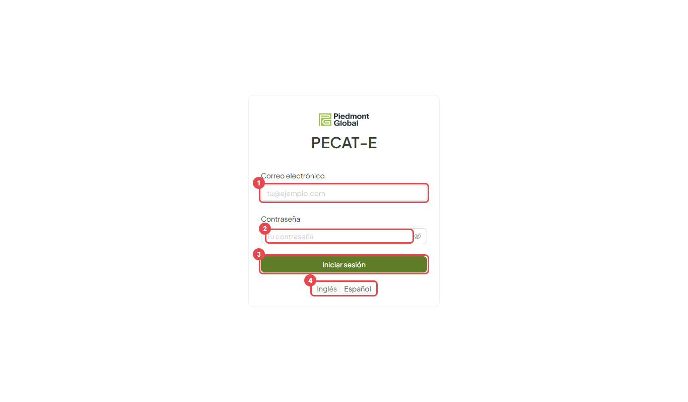
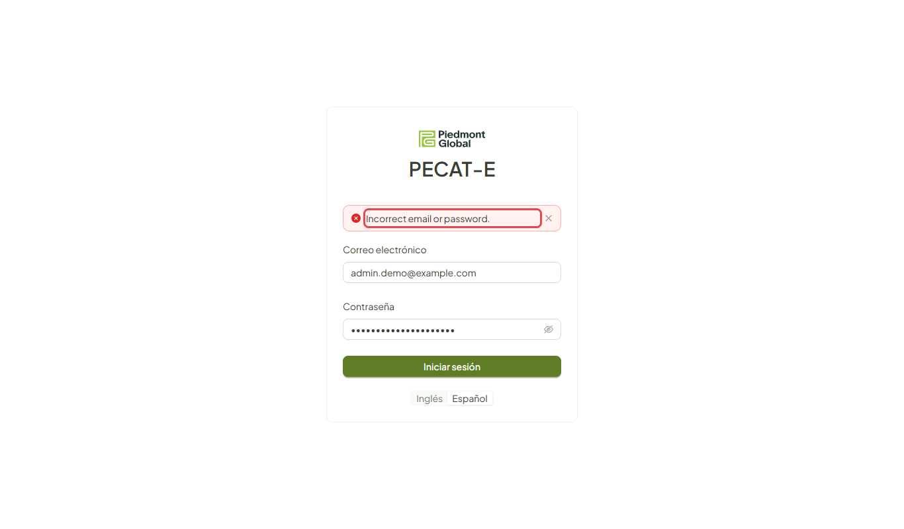
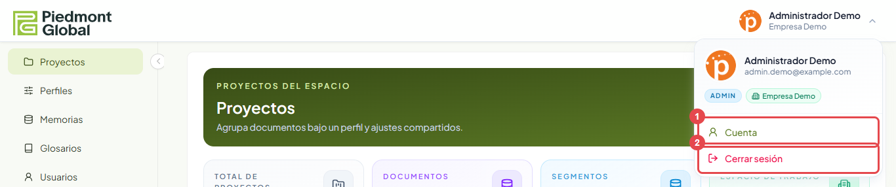
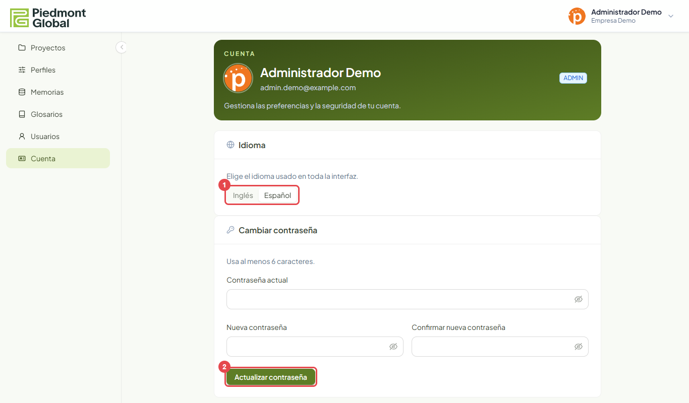

# Acceso y cuenta

Verificado 2026-10-13 · Fuente: la aplicación en el entorno de pruebas. Vale para los dos roles.

## Iniciar sesión

Abre la dirección de PECAT-E que te haya dado tu administrador. Verás la pantalla de acceso.

1. Escribe tu **correo electrónico**.
2. Escribe tu **contraseña**.
3. Pulsa **Iniciar sesión**.
4. Si quieres, cambia antes el idioma de la pantalla entre **Inglés** y **Español**.

No hay registro libre ni enlace para recuperar la contraseña. Las cuentas las crea un Administrador, que te da tu
contraseña inicial. Si la olvidas, pídele que te ponga una nueva.

### Si el correo o la contraseña no son correctos

Aparece un aviso encima del formulario. En esta versión el aviso sale en inglés aunque la pantalla esté en español:
«Incorrect email or password.»

## El menú de tu cuenta

Arriba a la derecha están tu nombre y tu espacio de trabajo. Al pulsarlos se abre un menú con tu rol y dos opciones.

1. **Cuenta** abre tus preferencias.
2. **Cerrar sesión** te devuelve a la pantalla de acceso.

## Cuenta

También se llega desde **Cuenta**, en el menú de la izquierda.

### Cambiar el idioma

En **Idioma**, elige **Inglés** o **Español** (1). El cambio se aplica al momento y queda guardado en tu cuenta: lo
verás igual en cualquier equipo desde el que entres.

### Cambiar la contraseña

1. Escribe tu **contraseña actual**.
2. Escribe la **nueva contraseña** dos veces. Debe tener al menos 6 caracteres.
3. Pulsa **Actualizar contraseña** (2).

Cambia la contraseña inicial la primera vez que entres.
