# Manual del Administrador

Verificado 2026-10-13 · Fuente: la aplicación en el entorno de pruebas, con el usuario «Administrador Demo» del
espacio «Empresa Demo». Lo que no se ha comprobado en pantalla va marcado.

El Administrador prepara los recursos de traducción, crea los proyectos, sube los documentos, reparte el trabajo y
entrega el resultado. Todo lo que hace queda dentro de su espacio de trabajo.

## La pantalla inicial

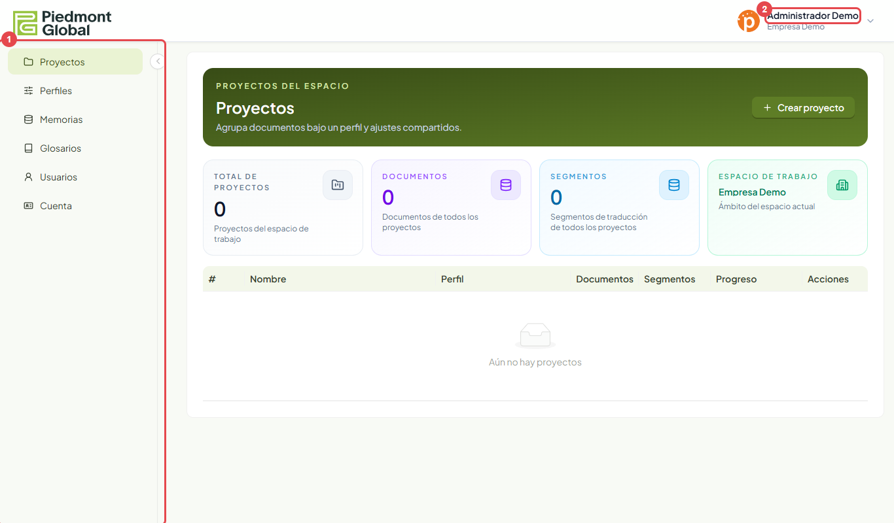

1. El **menú**: Proyectos, Perfiles, Memorias, Glosarios, Usuarios y Cuenta.
2. Tu **nombre y tu espacio de trabajo**, con el menú de la cuenta.

### Orden recomendado la primera vez

| Paso | Dónde | Para qué |
|---|---|---|
| 1 | [Usuarios](#usuarios) | Dar de alta a traductores y revisores |
| 2 | [Memorias](#memorias-de-traduccion) y [Glosarios](#glosarios) | Cargar traducciones y términos que ya tengas (opcional) |
| 3 | [Perfiles](#perfiles) | Reunir memorias, glosarios y ajustes en un perfil |
| 4 | [Proyectos](#proyectos) | Crear el proyecto con ese perfil |
| 5 | [Documentos](#subir-documentos) | Subir los ficheros y dejar que se traduzcan |
| 6 | [Asignación](#asignar-traductor-y-revisor) | Dar cada documento a un traductor y a un revisor |
| 7 | [Seguimiento y entrega](#seguimiento) | Vigilar el avance, cerrar el trabajo y descargar |

## Usuarios

Menú **Usuarios**. Ves a las personas de tu espacio, cuántas hay de cada rol y un buscador por nombre, correo o rol.

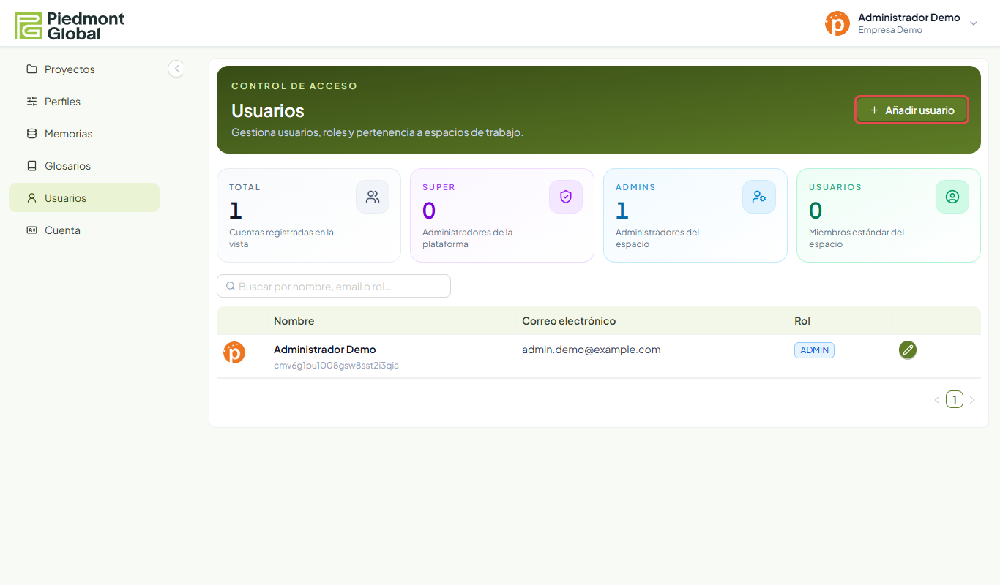

### Dar de alta a un usuario

Pulsa **Añadir usuario** y rellena la ventana.

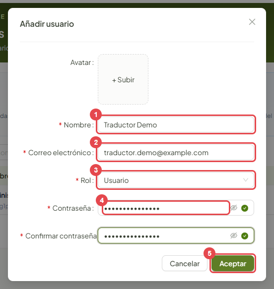

1. **Nombre** de la persona.
2. **Correo electrónico**: será su identificador para entrar.
3. **Rol**: **Usuario** para traductores y revisores, **Administrador** para otro gestor del espacio.
4. **Contraseña** y su confirmación.
5. **Aceptar**.

El avatar es opcional (imagen JPG o PNG de menos de 2 MB). El usuario queda dentro de tu espacio de trabajo.

La plataforma no envía ningún correo: comunícale tú la dirección, su correo y su contraseña, y pídele que la cambie
en **Cuenta** al entrar.

### Editar un usuario o cambiarle la contraseña

Pulsa el lápiz de su fila.

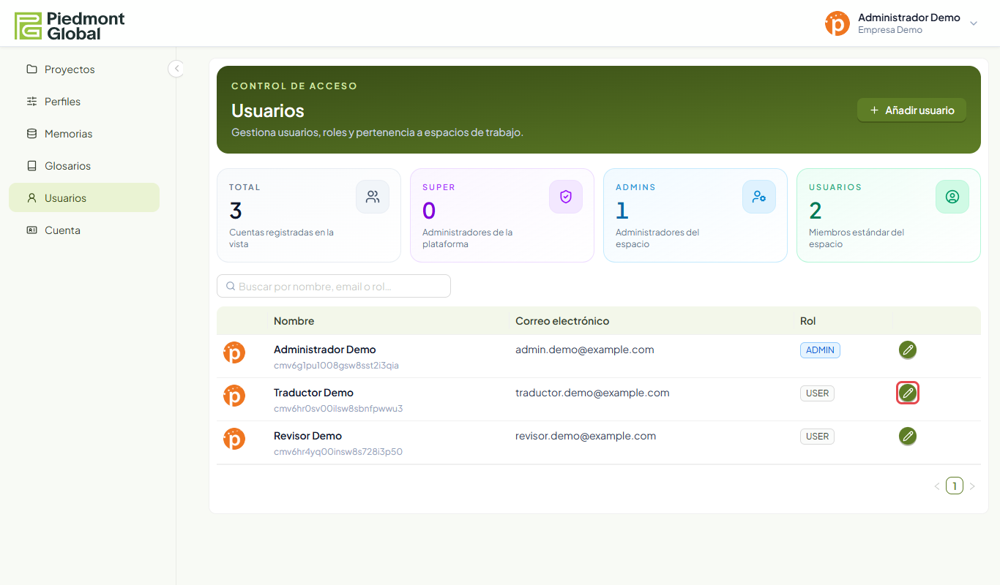

La ventana de edición sale en inglés en esta versión. Tiene dos pestañas:

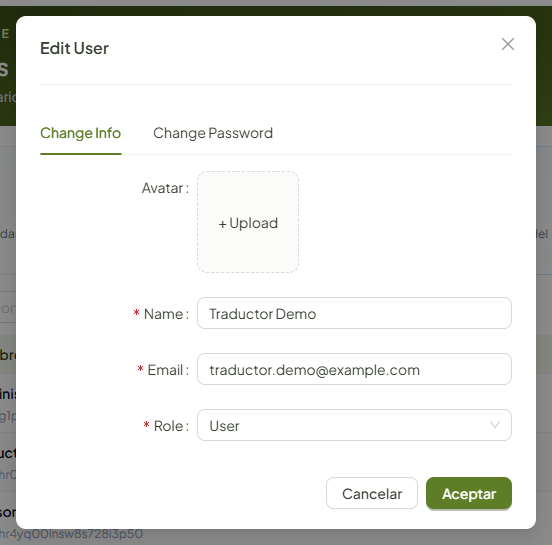

- **Change Info**: nombre (*Name*), correo (*Email*) y rol (*Role*).
- **Change Password**: una contraseña nueva para esa persona. Es la forma de resolver una contraseña olvidada.

### Eliminar un usuario

En esta versión la lista **no ofrece al Administrador el botón de eliminar**. Si alguien deja el equipo, cámbiale la
contraseña para cerrarle el acceso y pide la baja al responsable de la plataforma.

## Memorias de traducción

Menú **Memorias**. Una memoria guarda pares de frases ya traducidas. Al traducir un documento, la plataforma
reutiliza las coincidencias.

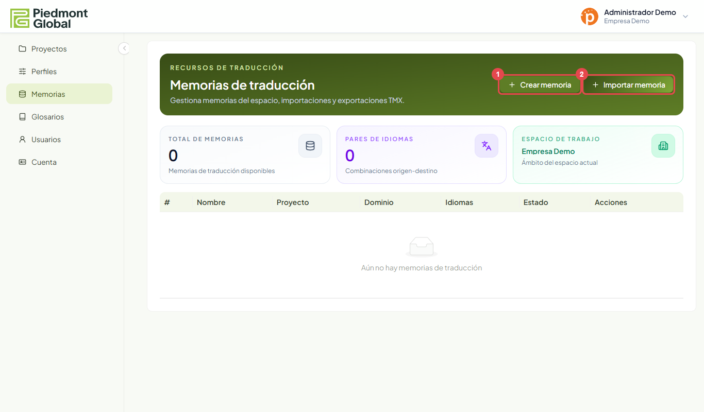

1. **Crear memoria** crea una memoria vacía.
2. **Importar memoria** crea una memoria a partir de un fichero TMX.

### Importar un TMX

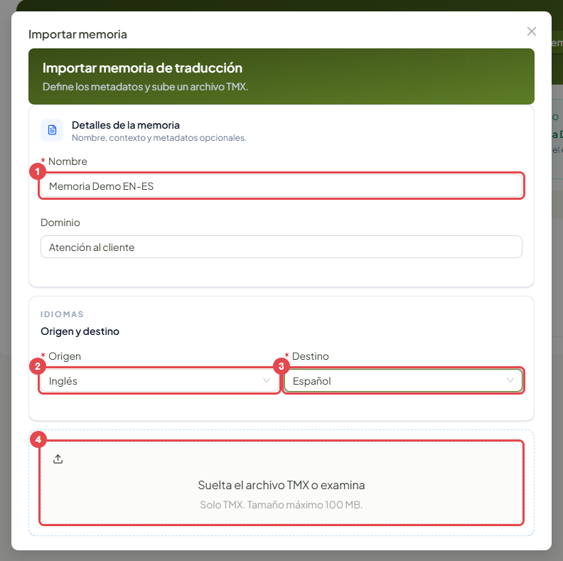

1. Escribe el **Nombre**. El **Dominio** es opcional y sirve para clasificar.
2. Elige el idioma de **Origen**.
3. Elige el idioma de **Destino**, distinto del origen.
4. Suelta el fichero **TMX** en la zona de abajo, o púlsala para buscarlo. Tamaño máximo: 100 MB.

La zona de subida solo se activa cuando el nombre y los dos idiomas están puestos. **La subida empieza sola al
soltar el fichero**; no hay botón final.

### El estado de una memoria

Una memoria recién importada no se puede usar todavía: la plataforma tiene que indexarla.

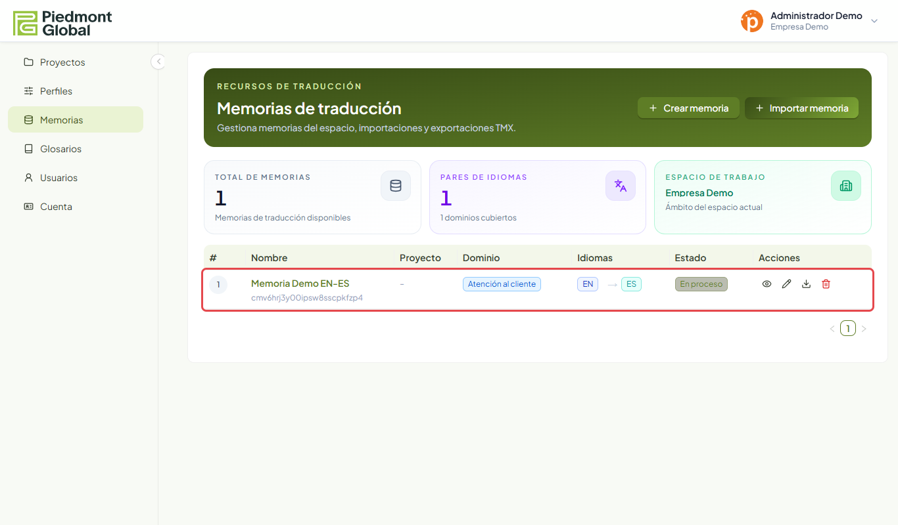

| Estado | Significado |
|---|---|
| Programado, En proceso, Reconstruyendo | Se está preparando. Espera |
| Disponible | Lista para usar |
| Error | La importación falló. Revisa el fichero y vuelve a importarlo |

En el ejemplo, una memoria de 10 unidades tardó menos de un minuto en pasar a **Disponible**.

### Crear una memoria vacía

Sirve para ir guardando en ella las traducciones que se confirmen (ver
[memorias que se actualizan](editor.md#memorias-que-se-actualizan-al-confirmar)).

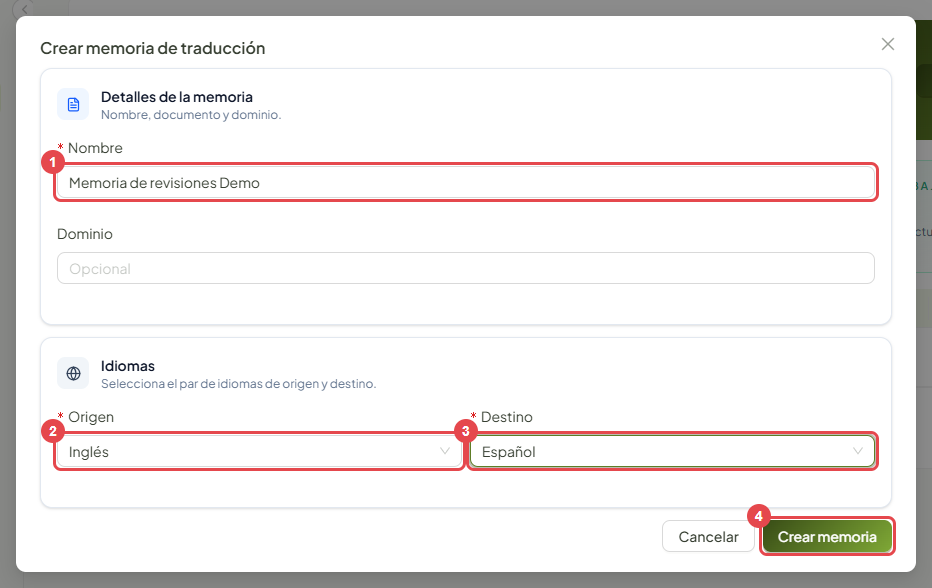

1. **Nombre**.
2. **Origen**.
3. **Destino**.
4. **Crear memoria**.

### Consultar, exportar o eliminar

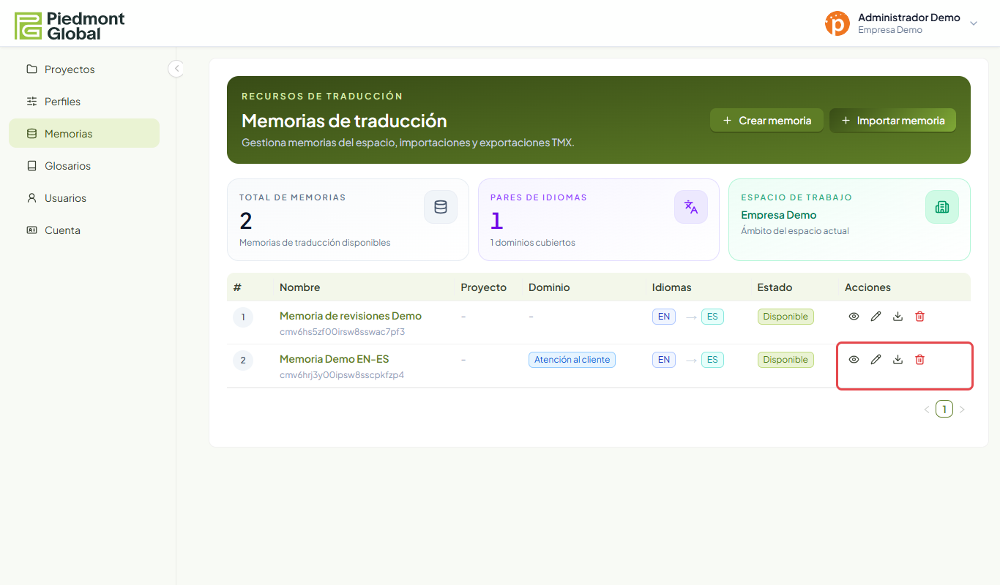

Las acciones de cada fila, de izquierda a derecha:

| Icono | Acción |
|---|---|
| Ojo | **Ver memoria**: sus unidades, con buscador |
| Lápiz | **Editar memoria**: nombre y datos |
| Flecha hacia abajo | **Exportar TMX** |
| Papelera | **Eliminar memoria**, con confirmación |

El detalle de la memoria sale en inglés en esta versión: *Source* es el origen, *Target* el destino y
*Search segments* el buscador.

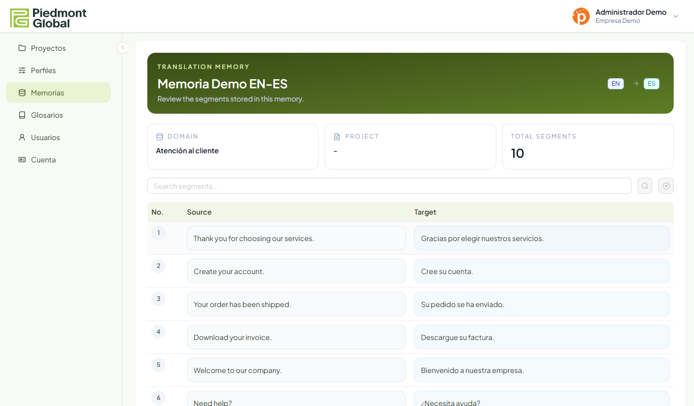

## Glosarios

Menú **Glosarios**. Un glosario es una lista de términos con la traducción que debe usarse.

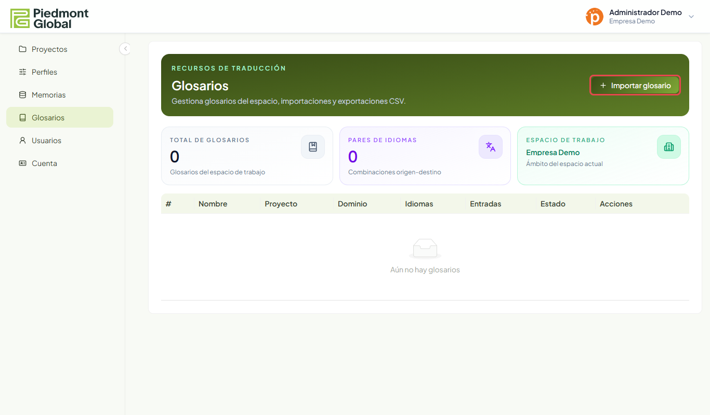

### Importar un glosario

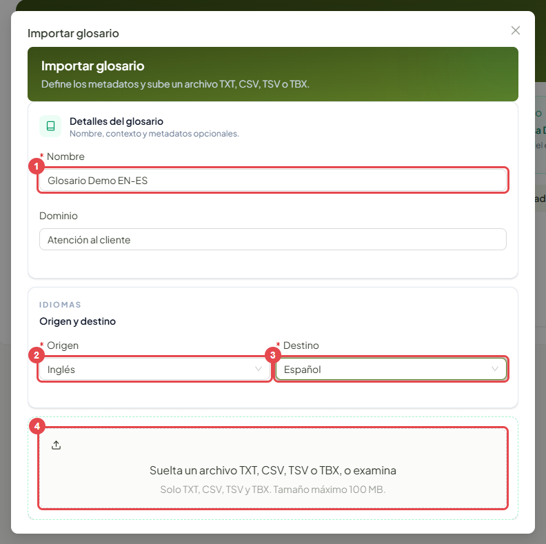

1. **Nombre** (y **Dominio**, opcional).
2. **Origen**.
3. **Destino**.
4. Suelta el fichero. La subida empieza sola.

**Formato del fichero.** Usa **CSV o TSV** con dos columnas, término de origen y término de destino, sin fila de
cabecera. El separador puede ser coma, tabulador o punto y coma. Ejemplo:

```text
invoice,factura
customer account,cuenta de cliente
help centre,centro de ayuda
```

La ventana menciona también TXT y TBX, pero en esta versión el servidor los rechaza con el aviso «The file type is
not allowed. Use TMX, CSV or TSV.» (comprobado el 2026-10-13).

### Consultar, exportar o eliminar

La lista muestra las **Entradas** de cada glosario y su **Estado**, con el mismo significado que en las memorias.
Las acciones son las mismas: ver, editar, **exportar CSV** y eliminar.

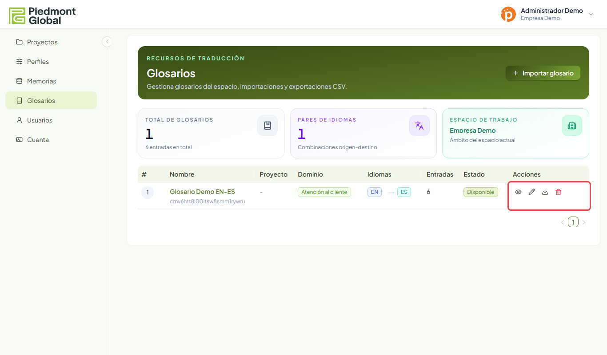

El detalle del glosario también sale en inglés.

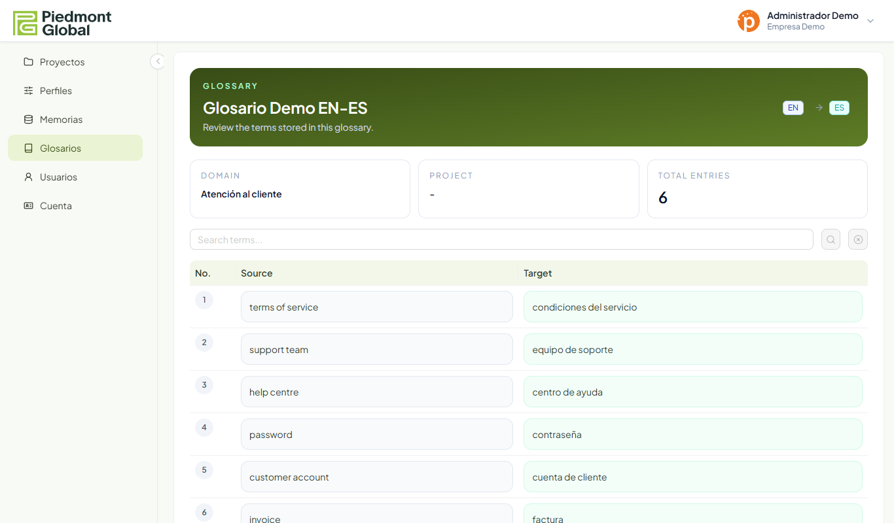

## Perfiles

Menú **Perfiles**. Un perfil es un conjunto de ajustes de traducción que se reutiliza: formalidad, instrucciones,
memorias, glosarios y nivel de calidad. Todo documento se traduce con un perfil.


### Crear un perfil

Pulsa **Crear perfil**. Es un asistente de tres pasos.

**Paso 1 · Detalles**

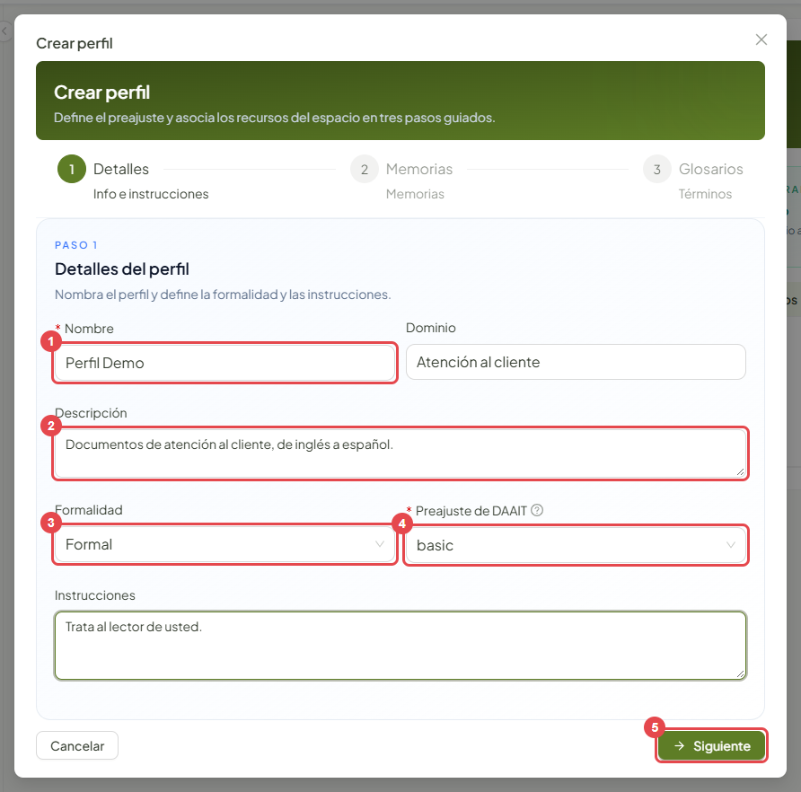

1. **Nombre** del perfil. El **Dominio** es opcional.
2. **Descripción**: para qué sirve. Rellénala siempre; el asistente la pide.
3. **Formalidad**: Sin formalidad, Formal, Neutro o Informal.
4. **Preajuste de DAAIT**: el nivel de calidad del motor. Es obligatorio.
5. **Siguiente**.

En **Instrucciones** puedes escribir indicaciones libres para el motor, por ejemplo «Trata al lector de usted».

Los preajustes disponibles:

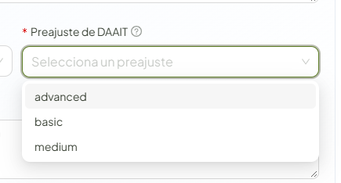

| Preajuste | Nivel |
|---|---|
| `basic` | El esencial. Es el que usa el ejemplo de este manual |
| `medium` | Calidad intermedia |
| `advanced` | La calidad más alta |

**Paso 2 · Memorias**

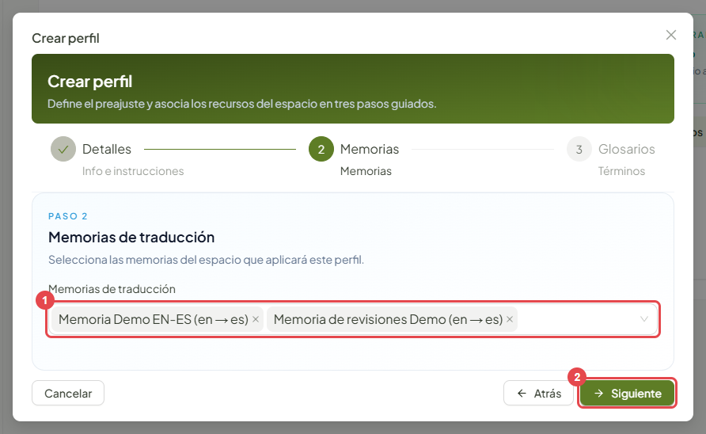

Elige las memorias del espacio que aplicará el perfil (1) y pulsa **Siguiente** (2). Puedes no elegir ninguna.

**Paso 3 · Glosarios**

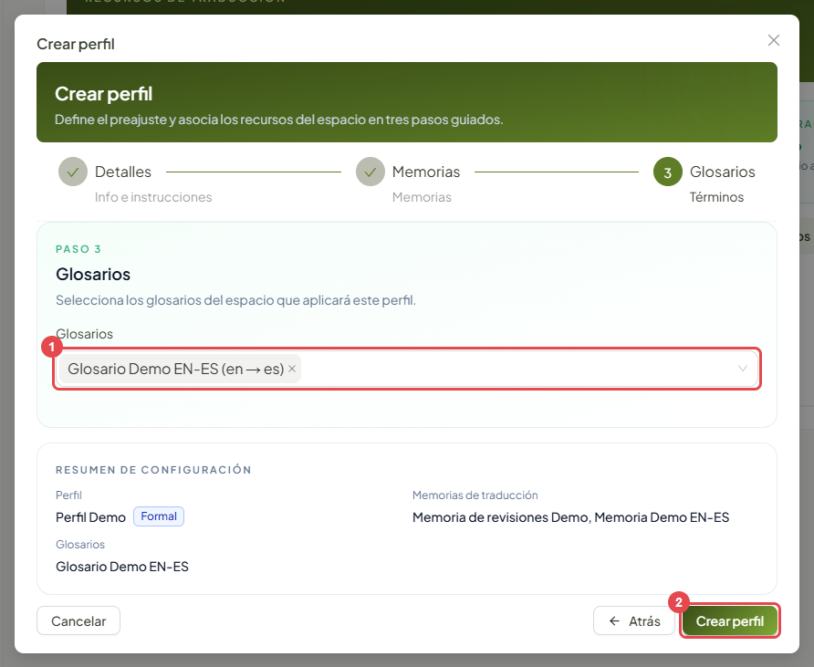

Elige los glosarios (1), repasa el **Resumen de configuración** y pulsa **Crear perfil** (2).

El perfil no lleva idiomas. El par de idiomas se elige al subir cada documento, y a ese documento solo se le aplican
las memorias y los glosarios del perfil que coinciden con su par.

### Editar, clonar o eliminar

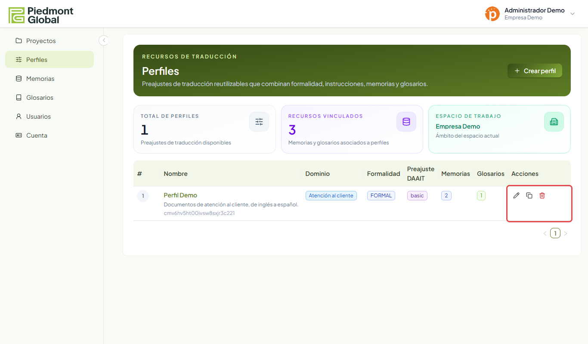

| Icono | Acción |
|---|---|
| Lápiz | **Editar perfil** |
| Dos hojas | **Clonar perfil** |
| Papelera | **Eliminar perfil**, con confirmación |

**Editar** abre la ficha del perfil. Cambia los datos y pulsa **Guardar**; abajo, **Añadir** vincula más memorias o
glosarios y la papelera de cada uno lo quita del perfil.

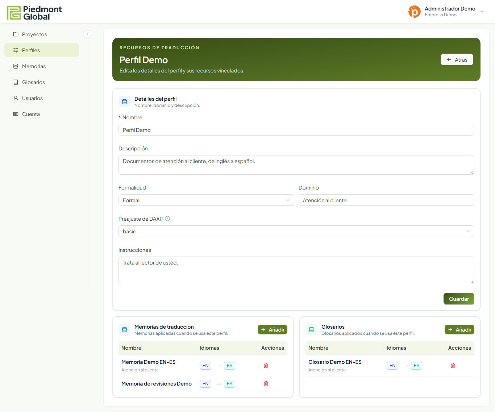

**Clonar** abre el mismo asistente ya relleno, con el nombre terminado en «(copia)». Úsalo para tener una variante
de un perfil, por ejemplo con otro preajuste.

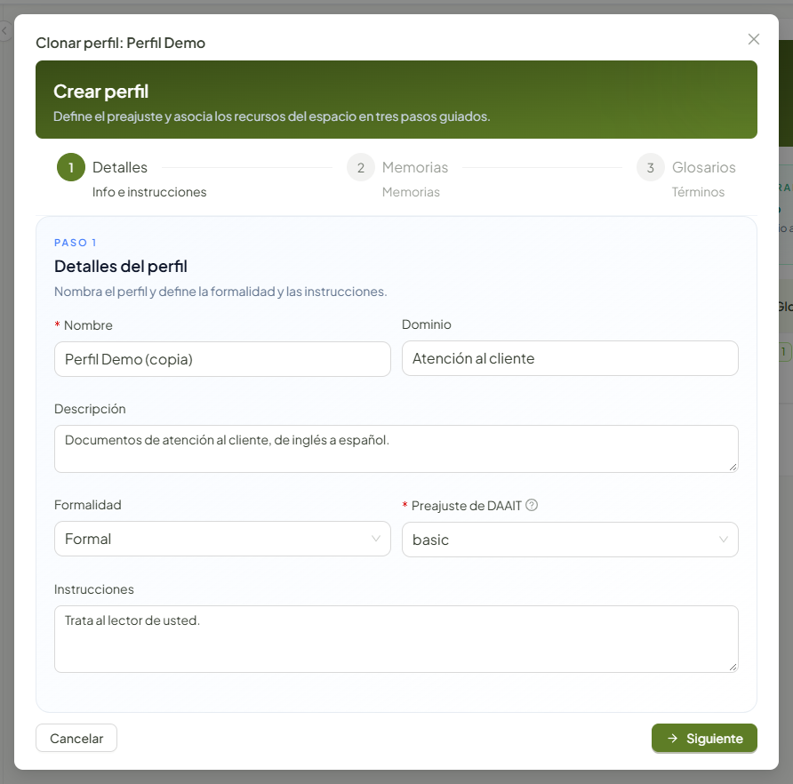

## Proyectos

Menú **Proyectos**. Un proyecto agrupa documentos que se traducen con el mismo perfil.

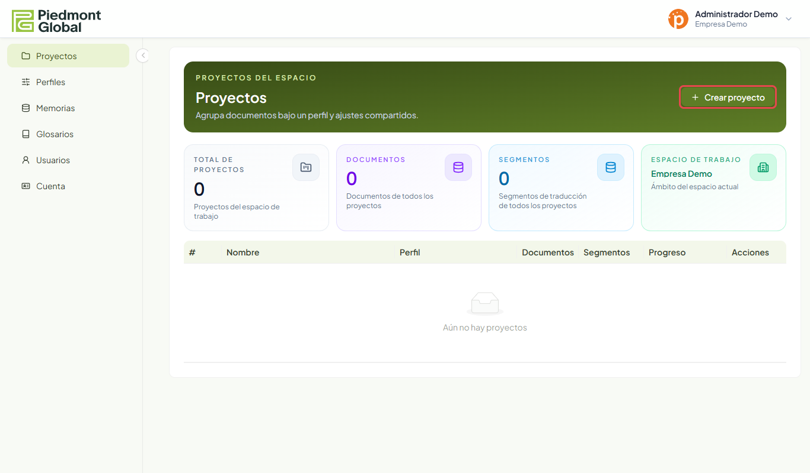

### Crear un proyecto

Pulsa **Crear proyecto**. Son dos pasos.

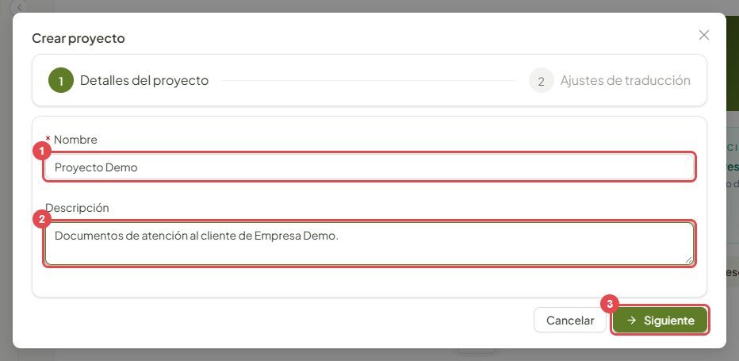

1. **Nombre**.
2. **Descripción** (opcional).
3. **Siguiente**.

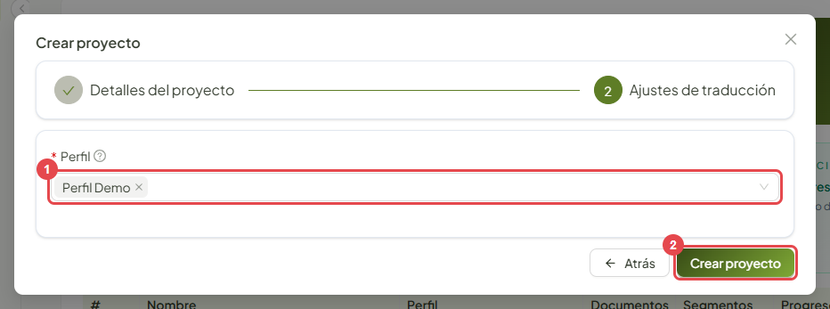

1. Elige el **Perfil**. Puedes elegir varios: el primero es el perfil por defecto y, al subir cada documento, se
   escoge con cuál de ellos se traduce.
2. **Crear proyecto**.

Sin perfil, un proyecto no admite documentos nuevos.

### La lista de proyectos

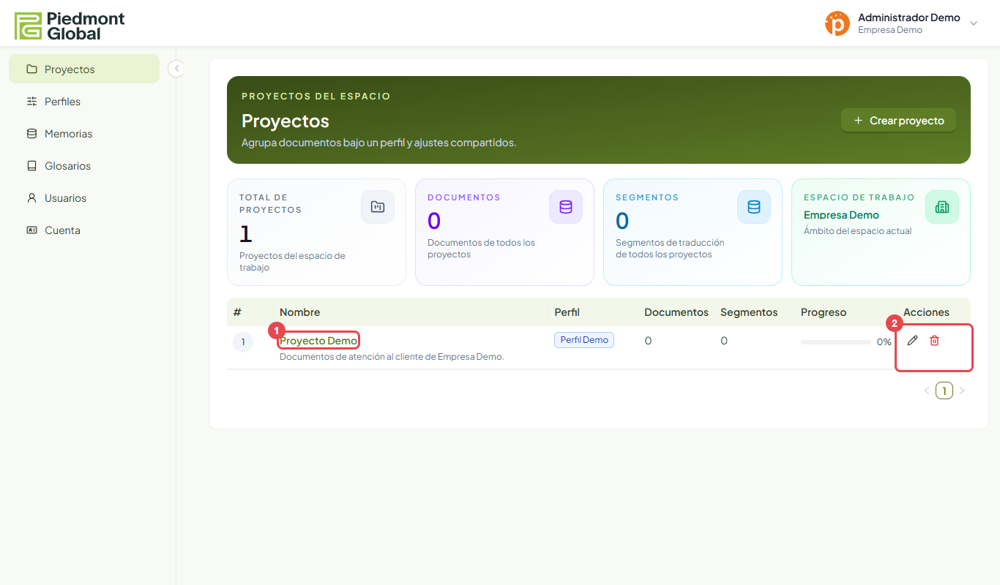

1. Pulsa el **nombre** para entrar en el proyecto.
2. El lápiz edita el proyecto y la papelera lo elimina. Un proyecto con documentos no se puede eliminar: elimina
   antes sus documentos.

La lista muestra, por proyecto, sus perfiles, cuántos documentos y segmentos tiene y el progreso de la revisión.

## Subir documentos

Entra en el proyecto y pulsa **Añadir documento**.

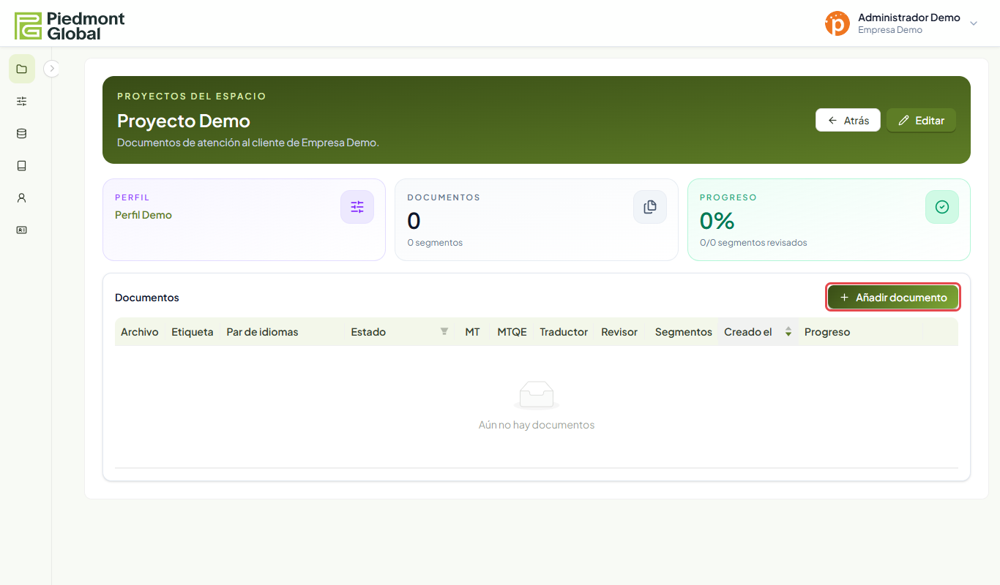

El asistente tiene tres pasos (su cabecera dice «cuatro»; son tres).

**Paso 1 · Idiomas**

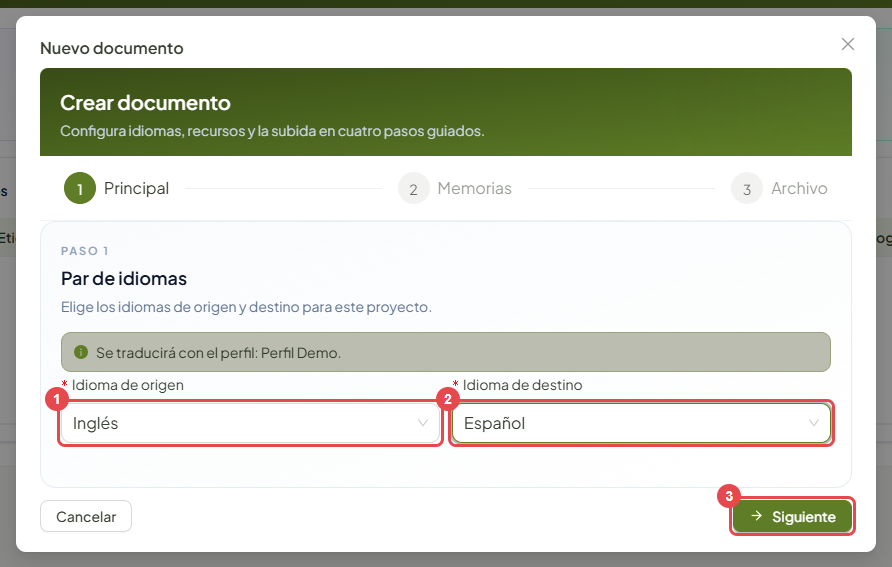

Elige el **idioma de origen** (1) y el **de destino** (2), y pulsa **Siguiente** (3). La lista de idiomas es larga:
escribe las primeras letras para filtrarla.

Si el proyecto tiene varios perfiles, este paso pide además el **Perfil de este documento** (según el código; el
proyecto de ejemplo tiene un solo perfil y no lo muestra).

**Paso 2 · Memorias y glosarios**

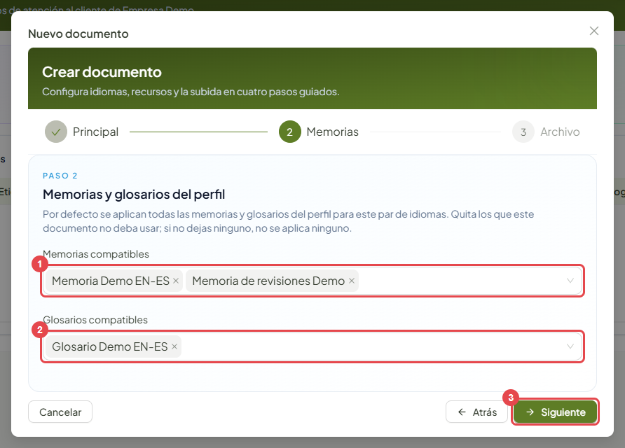

Vienen marcadas todas las memorias (1) y los glosarios (2) del perfil que valen para ese par de idiomas. Quita los
que este documento no deba usar; si no dejas ninguno, no se aplica ninguno.

**Paso 3 · Archivo**

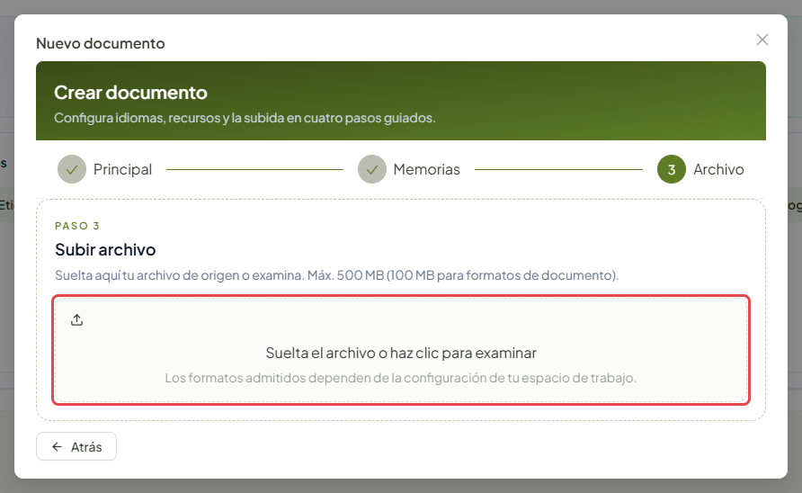

Suelta el fichero en la zona marcada o púlsala para buscarlo. **La subida empieza sola** y puedes soltar varios
ficheros a la vez. Tamaño máximo: 500 MB, y 100 MB para formatos de documento.

Los formatos admitidos y el trato que recibe cada uno están en [Formatos y ejemplos](formatos.md).

### Mientras se traduce

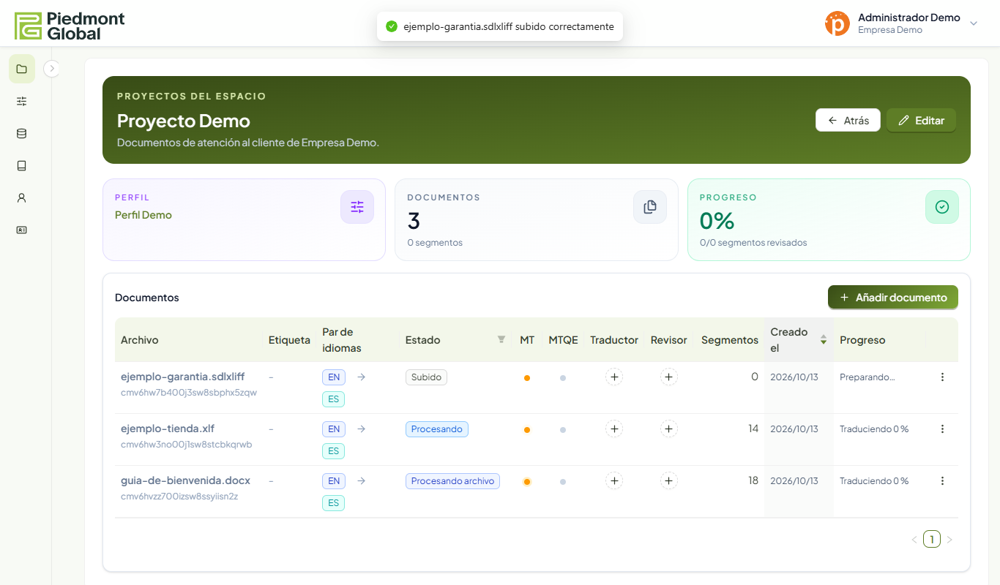

Cada documento pasa por estos estados:

| Estado | Qué ocurre |
|---|---|
| Subido | El fichero ha llegado y espera turno |
| Procesando, Procesando archivo | Se extraen los segmentos y se traducen |
| Listo | Ya se puede abrir y revisar |
| Error de archivo, Error de MTQE | Algo falló. Elimina el documento y vuelve a subirlo; si se repite, avisa al responsable de la plataforma |

La columna **Progreso** va diciendo «Preparando…», «Traduciendo N %» y «MTQE N %». Los puntos de **MT** (traducción)
y **MTQE** (nota de calidad) están en gris mientras esperan, en naranja mientras trabajan y en verde al terminar.
El nombre del documento no se puede abrir hasta que está **Listo**. La página se actualiza sola.

## La tabla de documentos

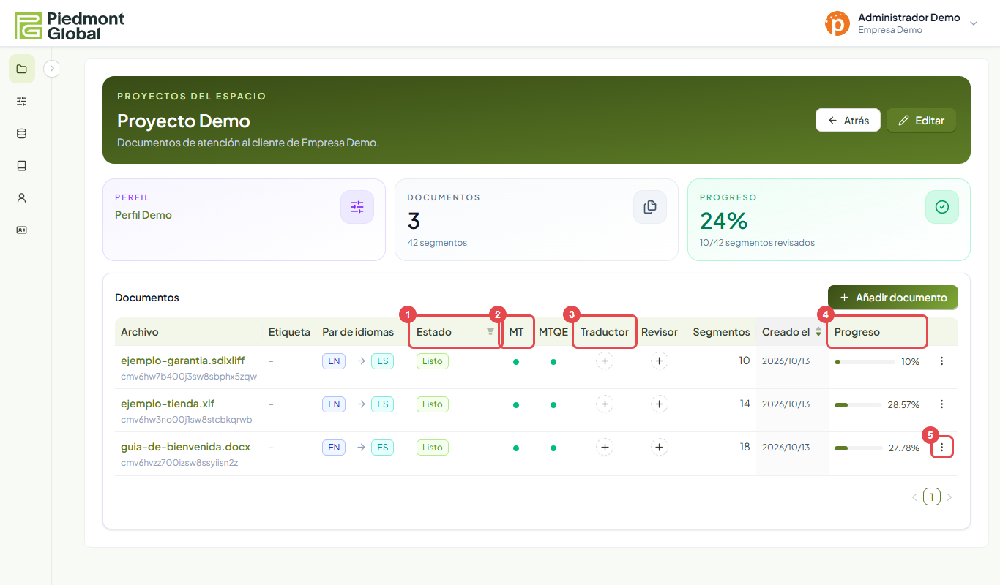

1. **Estado** del documento, con filtro.
2. **MT** y **MTQE**: los dos pasos automáticos.
3. **Traductor** y **Revisor** asignados.
4. **Progreso** de la revisión.
5. El menú **⋮** con las acciones del documento.

Pulsa el nombre de un documento para abrirlo en el [editor](editor.md).

### Asignar traductor y revisor

Un Usuario **solo ve los documentos que tiene asignados**. Hasta que no asignas, nadie más que tú puede trabajarlos.

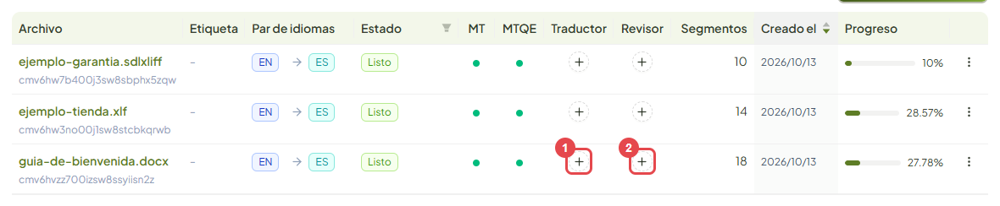

Pulsa el **+** de la columna **Traductor** (1) o **Revisor** (2), elige a la persona y pulsa **Aceptar**.

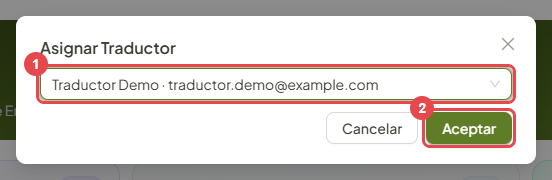

Una vez asignados, aparecen sus iniciales. La **x** roja de cada una quita la asignación.

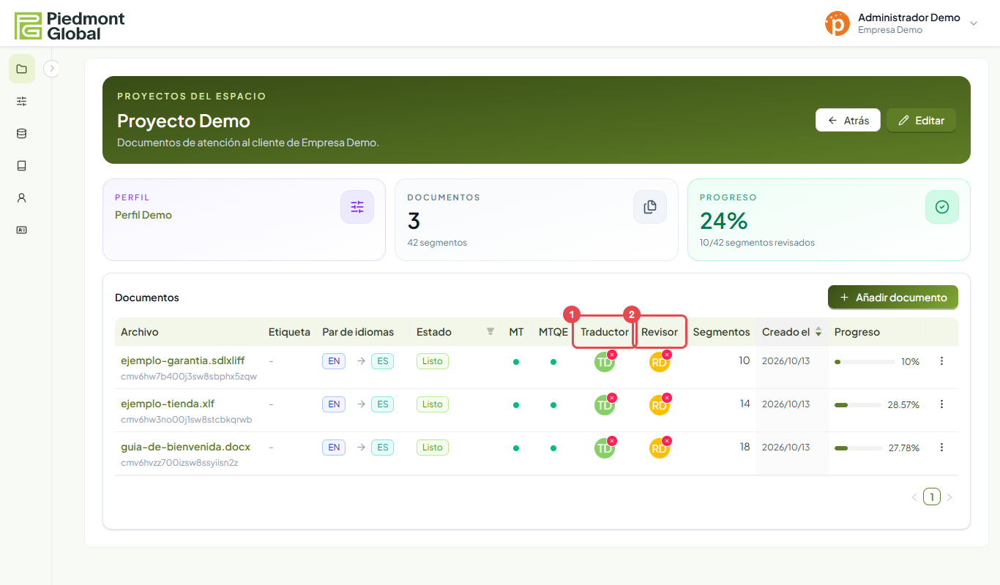

### El menú de un documento

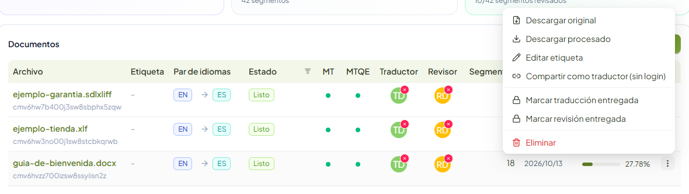

| Opción | Qué hace |
|---|---|
| Descargar original | Baja el fichero tal como se subió |
| Descargar procesado | Baja el fichero traducido (ver [Descargar](#descargar-el-resultado)) |
| Editar etiqueta | Pone una etiqueta corta al documento |
| Compartir como traductor (sin login) | Crea un enlace para revisar sin cuenta |
| Marcar traducción entregada | Cierra el trabajo del traductor |
| Marcar revisión entregada | Cierra el trabajo del revisor |
| Eliminar | Elimina el documento, con confirmación |

### Etiquetar un documento

La etiqueta es un texto libre que se ve en la tabla, por ejemplo «Urgente» o el nombre del cliente.

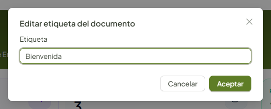

### Compartir con alguien sin cuenta

**Compartir como traductor (sin login)** crea un enlace que da acceso completo de revisión a ese único documento,
sin iniciar sesión.

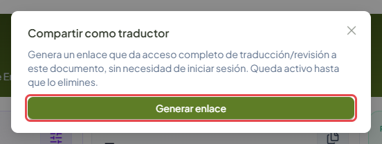

Pulsa **Generar enlace**.

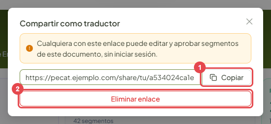

1. **Copiar** copia el enlace para enviarlo.
2. **Eliminar enlace** lo anula al instante.

Quien tenga el enlace puede editar y confirmar segmentos de ese documento. No caduca: **elimínalo cuando ya no haga
falta**.

## Seguimiento

La tabla de documentos muestra el avance de cada uno, y la tarjeta **Progreso** el del proyecto entero.

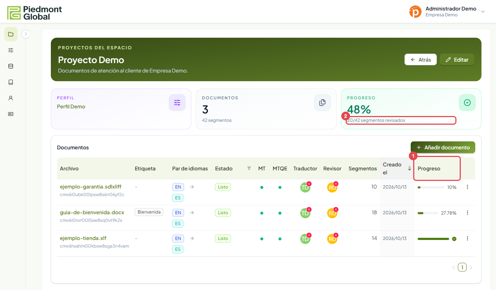

Un segmento cuenta como revisado cuando está confirmado o bloqueado. Por eso un documento puede empezar con parte
del progreso ya hecho: son sus segmentos bloqueados.

El filtro de la columna **Estado** deja en la tabla solo los documentos del estado que elijas.

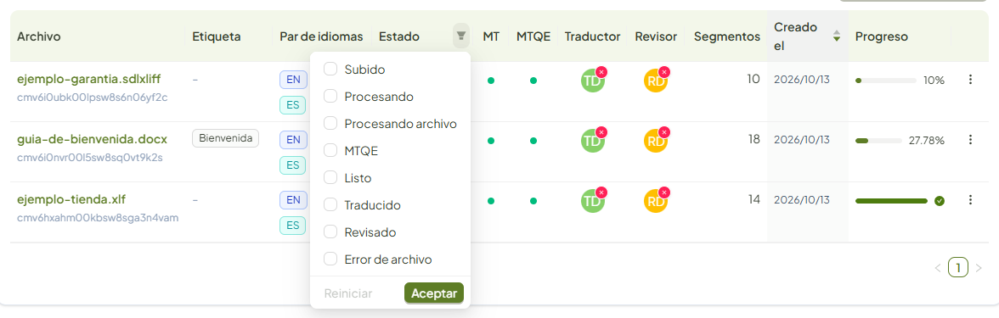

## Lo que el Administrador puede hacer en el editor

El editor es el mismo para todos y está explicado en [El editor](editor.md). El Administrador tiene además dos
cosas.

**Puede editar siempre**, aunque la traducción o la revisión estén entregadas.

**Puede bloquear y desbloquear segmentos.** Un segmento bloqueado no se puede editar y cuenta como terminado. Pulsa
el candado del segmento:

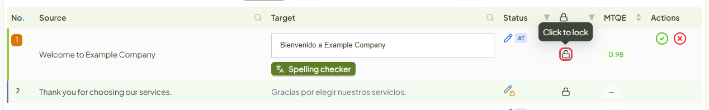

Al pasar el ratón por un candado cerrado se lee el motivo. El bloqueo hecho a mano dice «Locked manually»; pulsarlo
otra vez lo quita.

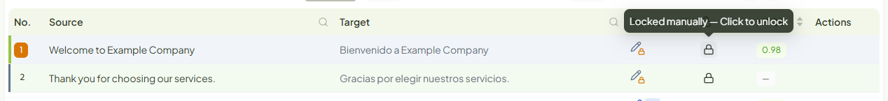

Desbloquear vale para cualquier bloqueo, también el de una coincidencia exacta de memoria o el que traía el fichero.

## Entregas

Cada documento tiene dos entregas: la de **traducción** y la de **revisión**. Se marcan desde el menú del documento.

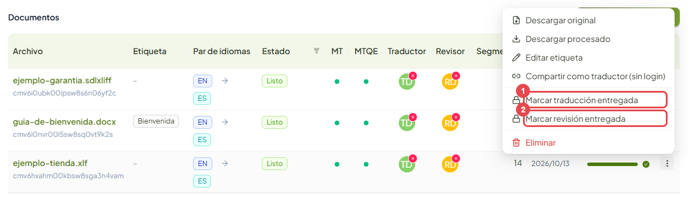

1. **Marcar traducción entregada**: el traductor ya no puede editar.
2. **Marcar revisión entregada**: el revisor ya no puede editar.

Al marcar la traducción, el estado del documento pasa a **Traducido**.


Al marcar también la revisión, pasa a **Revisado**.

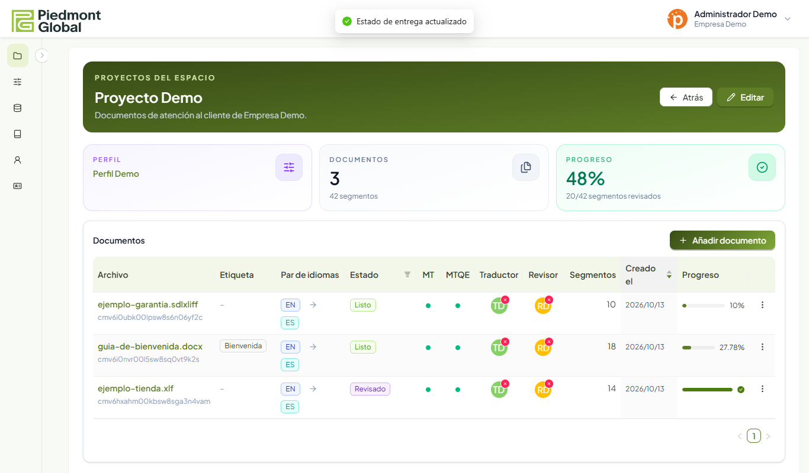

Si hay que seguir trabajando, el mismo menú ofrece **Reabrir traducción** y **Reabrir revisión**.

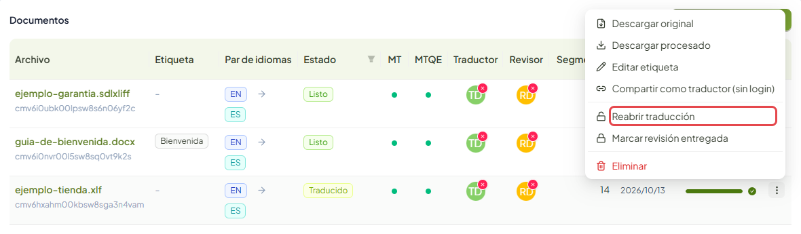

Los Usuarios no tienen botón para entregar. Acuerda con ellos que te avisen al terminar.

## Descargar el resultado

**Descargar procesado**, en el menú del documento o en el editor, baja el fichero traducido. Se llama como el
original más los idiomas, por ejemplo `guia-de-bienvenida-en_es.docx`.

- Si **todos los segmentos están confirmados o bloqueados**, se descarga directamente.
- Si **falta trabajo**, la plataforma te dice cuánto y te deja elegir.

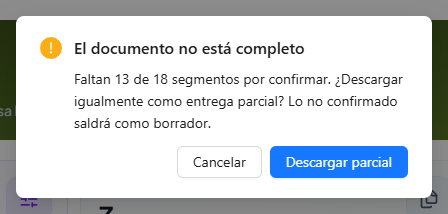

**Descargar parcial** baja el fichero igualmente: lo confirmado sale como definitivo y lo no confirmado sale como
borrador, con la traducción automática. Solo el Administrador puede hacerlo; a un Usuario la plataforma le dice
cuánto falta y no le deja descargar.

Qué lleva exactamente el fichero descargado en cada formato está en [Formatos y ejemplos](formatos.md).

## Eliminar un documento y editar el proyecto

**Eliminar**, en el menú del documento, pide confirmación. El documento desaparece de la tabla para todos.

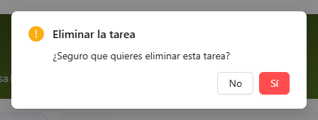

El botón **Editar** de la cabecera del proyecto cambia su nombre, sus perfiles y su descripción.

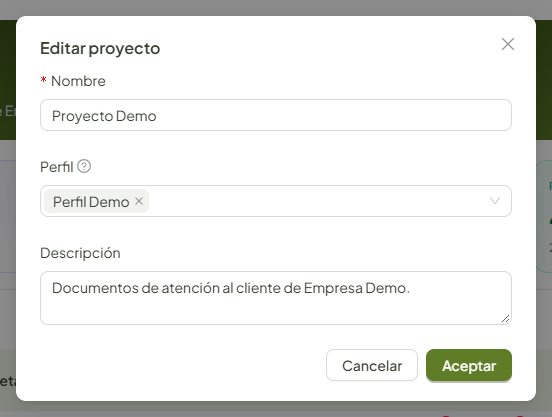
