# El editor

Verificado 2026-10-13 · Fuente: la aplicación en el entorno de pruebas, con el fichero de ejemplo
[`ejemplo-tienda.xlf`](ejemplos/ejemplo-tienda.xlf). Lo que no se ha comprobado en pantalla va marcado.

El editor es la pantalla donde se revisa un documento, segmento a segmento. Es el mismo para el Administrador y para
el Usuario. Se abre pulsando el nombre de un documento que esté en estado **Listo**.

En esta versión casi todos los rótulos del editor salen en inglés aunque tengas la interfaz en español. Aquí se
nombran como aparecen.

## La pantalla

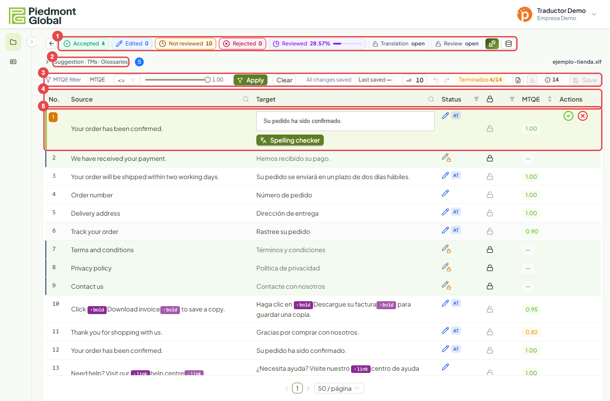

1. **Contadores** del documento y estado de las entregas.
2. **Panel de ayudas**: sugerencia, coincidencias de memoria y términos de glosario del segmento activo.
3. **Barra de trabajo**: filtro por nota, guardado, confirmar todo, deshacer, terminados y descargas.
4. **Cabecera de la rejilla**, con búsqueda, filtros y orden.
5. El **segmento activo**, abierto para editar.

### Los contadores

| Rótulo | Qué cuenta |
|---|---|
| Accepted | Segmentos confirmados sin cambios, y los bloqueados |
| Edited | Segmentos confirmados con cambios |
| Not reviewed | Segmentos que nadie ha confirmado todavía |
| Rejected | Segmentos rechazados |
| Reviewed | Porcentaje del documento ya resuelto |
| Translation · Review | Si la traducción y la revisión siguen abiertas (`open`) o están entregadas (`submitted`) |

A su derecha hay dos botones: el [esfuerzo de traducción](#el-esfuerzo-de-traduccion) y las
[memorias que se actualizan](#memorias-que-se-actualizan-al-confirmar). La flecha de la izquierda vuelve al
proyecto.

### Las columnas

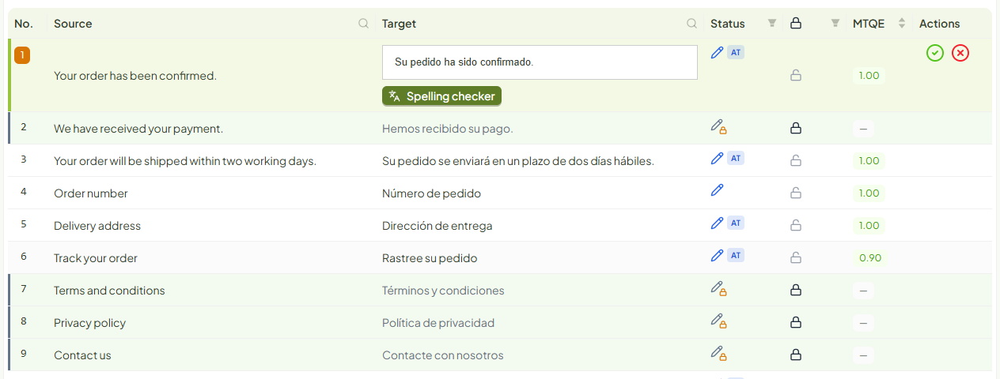

| Columna | Contenido |
|---|---|
| No. | Número del segmento. En `.xlf` y `.sdlxliff` es el mismo número que muestra Trados |
| Source | Texto original |
| Target | Traducción |
| Status | Situación del segmento y origen de su traducción |
| Candado | Si el segmento está bloqueado |
| MTQE | Nota de calidad estimada, de 0 a 1 |
| Actions | Confirmar y rechazar, en el segmento activo |

## Los estados de un segmento

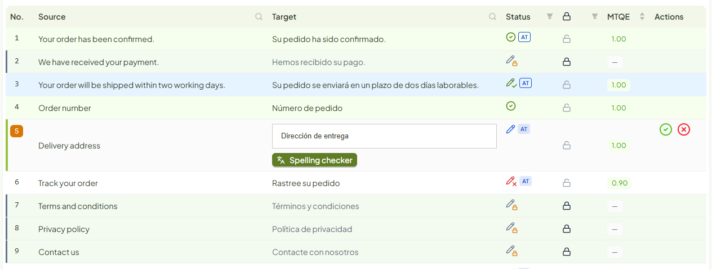

| Icono de Status | Estado | Fila |
|---|---|---|
| Lápiz azul | **Sin revisar**: nadie lo ha confirmado | Blanca |
| Círculo verde con marca | **Confirmado** sin cambios | Verde claro |
| Lápiz verde con marca | **Confirmado con cambios** | Azul claro |
| Lápiz rojo con aspa | **Rechazado** | Rojo claro |
| Lápiz gris con candado | **Bloqueado** | Verde claro, con barra a la izquierda y texto gris |

Junto al icono puede haber una etiqueta con el **origen** de la traducción:

| Etiqueta | Significado |
|---|---|
| `AT` | La tradujo la plataforma (traducción automática) |
| Un porcentaje, como `85%` | Venía en el fichero como coincidencia parcial de memoria |
| Sin etiqueta | Venía traducida en el fichero (en documentos subidos antes del 14-10-2026, también una coincidencia exacta de memoria) |

La etiqueta va rellena mientras el texto es el que produjo ese origen, y queda solo con el borde cuando alguien lo
ha cambiado.

### La nota MTQE

Es una estimación automática de la calidad de la traducción: cuanto más cerca de 1, mejor. Sirve para decidir por
dónde empezar, no sustituye a la revisión. Los segmentos bloqueados no llevan nota y muestran «—». La nota se vuelve
a calcular cuando confirmas un segmento.

## Revisar un segmento

Pulsa la traducción de un segmento para abrirlo.

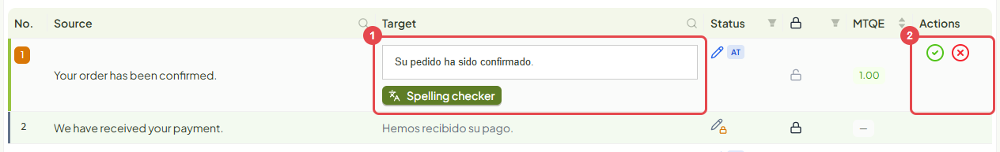

1. La **caja de edición** con la traducción.
2. Los botones **confirmar** (verde) y **rechazar** (rojo).

### Confirmar

Si la traducción es correcta, pulsa `Ctrl+Enter` o el botón verde. El segmento pasa a **Confirmado** y el editor
abre el siguiente que no esté bloqueado.

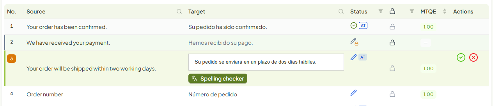

**Las repeticiones se confirman solas.** Si otro segmento del documento tiene exactamente el mismo texto original,
queda confirmado con la misma traducción. En el ejemplo, confirmar el segmento 1 confirmó también el 12.

### Corregir

Escribe la corrección en la caja. Mientras no la guardes, la barra avisa de que hay cambios sin guardar.

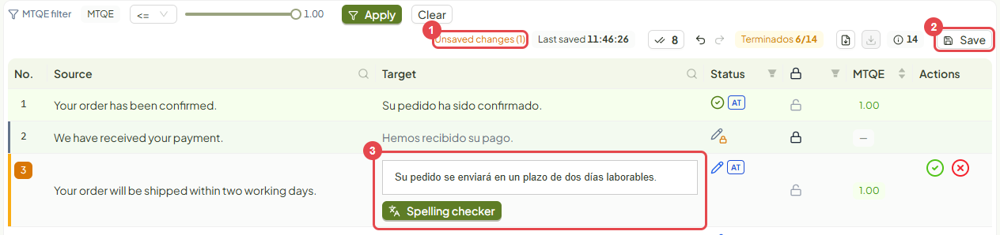

1. **Unsaved changes** indica cuántos segmentos tienen texto sin guardar.
2. **Save** (o `Ctrl+S`) guarda lo escrito **sin confirmarlo**. El segmento sigue sin revisar; sirve para dejar un
   borrador y volver luego.
3. La caja con tu texto.

Cuando la corrección esté lista, confirma con `Ctrl+Enter`. El segmento queda **Confirmado con cambios**.

Un borrador guardado sin confirmar **no sale en el fichero descargado**: ahí sale la traducción anterior. Está
comprobado para `.xlf` y `.sdlxliff` por las pruebas automáticas del repositorio; no se ha comprobado en pantalla en
esta revisión.

### Rechazar

Si la traducción no vale y no vas a corregirla ahora, pulsa `Ctrl+Mayús+Enter` o el botón rojo.

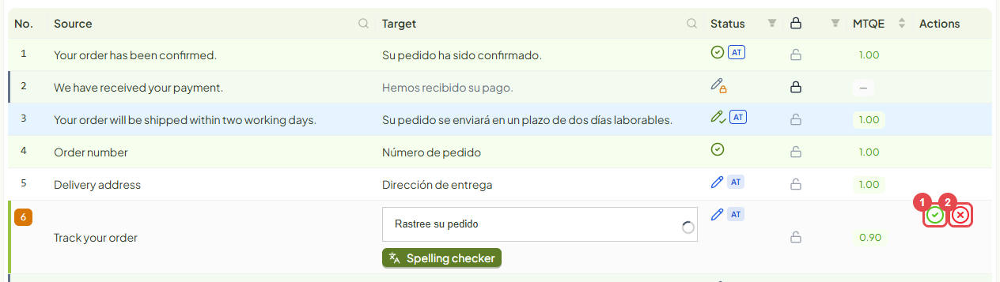

El texto no cambia. Un segmento rechazado **no cuenta como terminado**: para cerrar el documento hay que corregirlo
y confirmarlo.

### Segmentos con etiquetas

Algunos segmentos llevan etiquetas de formato del documento: negritas, enlaces, saltos. Se ven como fichas de color
dentro del texto.

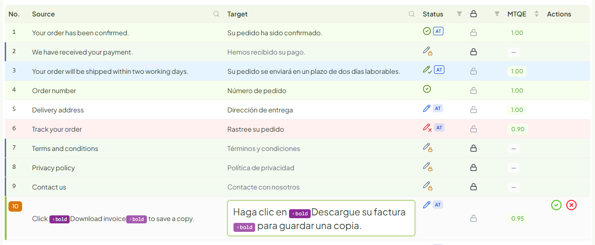

- Las etiquetas de la traducción tienen que ser **las mismas que las del origen y en el mismo orden**.
- Escribe y corrige el texto alrededor de ellas. El editor no deja borrarlas ni cambiarlas de orden.
- Cada pareja rodea el texto al que da formato: lo que quede entre la ficha de apertura y la de cierre saldrá, por
  ejemplo, en negrita.
- Si a la traducción le falta alguna etiqueta del origen, `Ctrl+,` inserta la siguiente que falta (no comprobado en
  esta revisión).

### Segmentos bloqueados

Un segmento bloqueado ya está resuelto. No se puede editar y el editor lo salta al avanzar. Pasa el ratón por su
candado para ver el motivo, que sale en inglés:

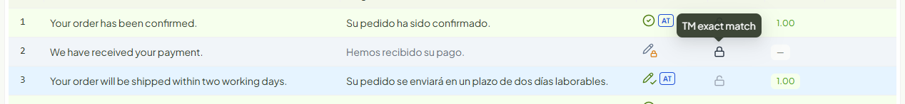

| Motivo | Significado |
|---|---|
| TM exact match | Coincidencia exacta con una memoria, en documentos subidos antes del 14-10-2026 (desde entonces una coincidencia exacta llega como `AT`, sin bloquear) |
| Locked in the source file | Venía bloqueado o aprobado en el fichero del cliente |
| Locked manually | Lo bloqueó un Administrador |

Si crees que un segmento bloqueado está mal, avisa a tu Administrador: él puede desbloquearlo.

## El historial de un segmento

Pasa el ratón por el icono de **Status** de un segmento. Se abre su historial: quién hizo cada cambio, cuándo, qué
acción fue, el texto antes y después y la nota MTQE.

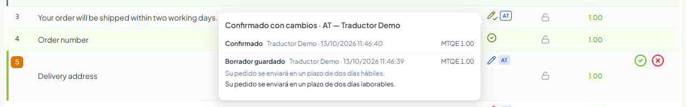

## El panel de ayudas

Pulsa **Suggestion · TMs · Glossaries**, encima de la barra de trabajo, para abrirlo o cerrarlo. Muestra lo que la
plataforma sabe del segmento activo. Los números junto al título dicen cuántas ayudas hay.

**Glossaries** lista los términos del glosario que aparecen en el segmento, con la traducción que debe usarse.

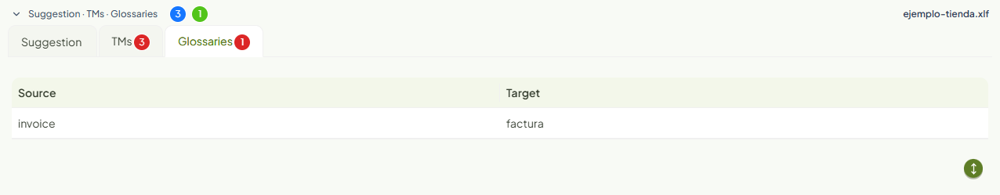

**TMs** lista las frases parecidas que hay en las memorias, con su grado de parecido (*Similarity*).

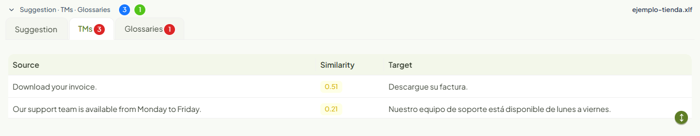

**Suggestion** muestra una propuesta alternativa cuando la hay. Con el preajuste `basic` del ejemplo no se genera
ninguna y el panel lo dice: «No LLM suggestion for this segment».

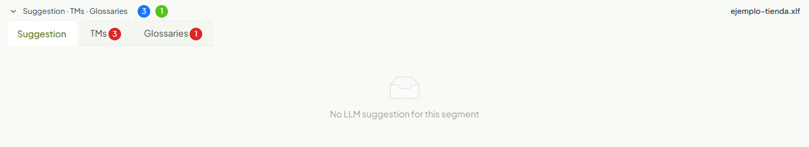

## Buscar y filtrar

### Por estado

Pulsa el embudo de la columna **Status**, marca lo que quieres ver y pulsa **Aceptar**. **Reiniciar** quita el
filtro.

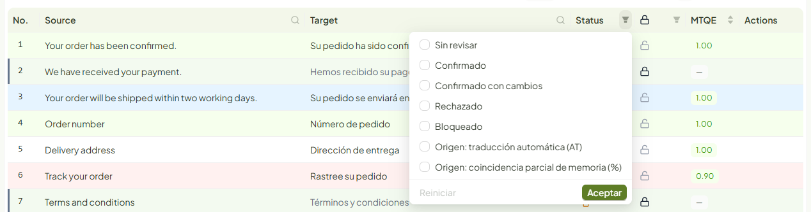

Con un filtro puesto, el embudo queda marcado y los contadores de la barra pasan a referirse a lo que se ve.

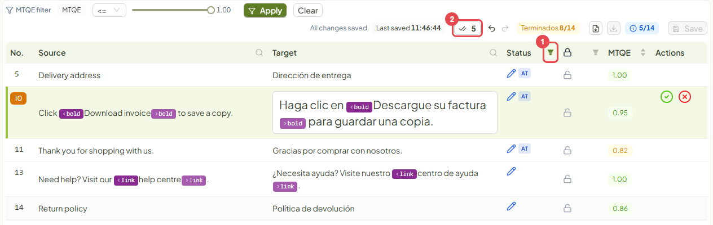

El embudo de la columna del **candado** filtra del mismo modo entre bloqueados y no bloqueados.

### Por texto

Pulsa la lupa de **Source** o de **Target**, escribe y pulsa **Search**. **Reset** quita la búsqueda.

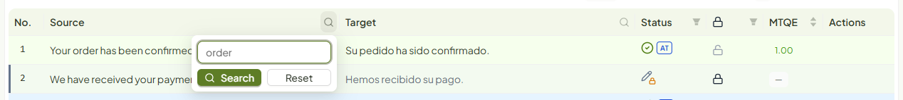

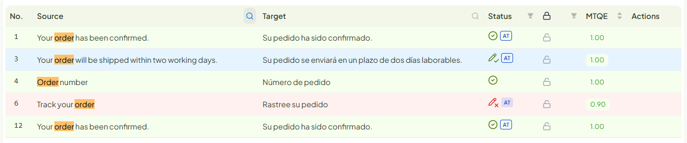

### Por nota MTQE

En **MTQE filter**, elige el operador (`<=`, `<`, `>=`, `>` o `=`), mueve el valor y pulsa **Apply**. Sirve para
empezar por los segmentos de nota más baja. **Clear** quita el filtro.

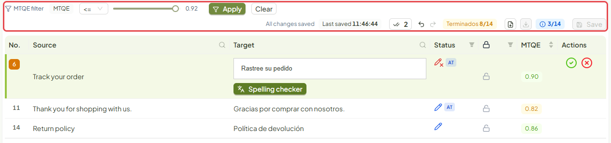

Las flechas de la columna **MTQE** ordenan la rejilla por nota.

## Deshacer y rehacer

Las dos flechas de la barra deshacen y rehacen la última acción: confirmar, rechazar, guardar un borrador o
confirmar todo. También con `Ctrl+Z` y `Ctrl+Y`. Al pasar el ratón, cada flecha dice qué acción va a deshacer.

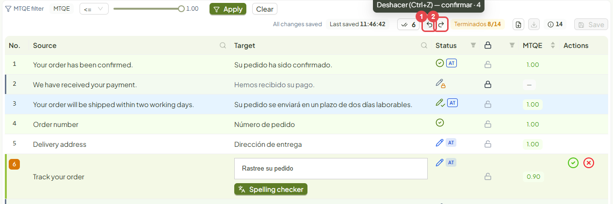

## Confirmar todo

El botón con dos marcas y un número confirma de una vez todos los segmentos sin revisar: los del filtro, si hay uno
puesto, o los del documento. El número dice cuántos son.

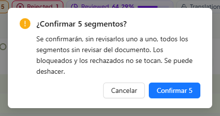

No toca los bloqueados ni los rechazados, y se puede deshacer. Úsalo cuando ya hayas leído esos segmentos: los da
por buenos sin abrirlos uno a uno.

## Terminar el documento

**Terminados** cuenta los segmentos resueltos, que son los confirmados y los bloqueados. Mientras falte alguno, al
pasar el ratón dice cuántos quedan y cuántos de ellos están rechazados.

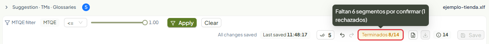

Cuando llega al total se pone en verde y se activa **Descargar procesado**.

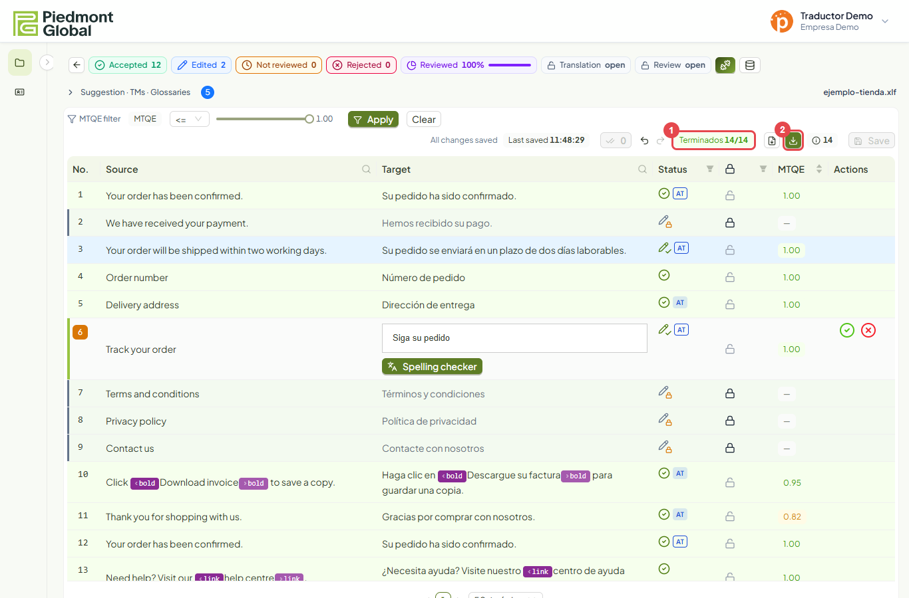

En la barra hay dos descargas: el fichero **original**, siempre disponible, y el **procesado**, con las traducciones
confirmadas.

## El esfuerzo de traducción

El botón verde junto a los contadores abre **Translation effort**: una estimación del trabajo de revisión que tiene
el documento, a partir de la nota MTQE de cada segmento.

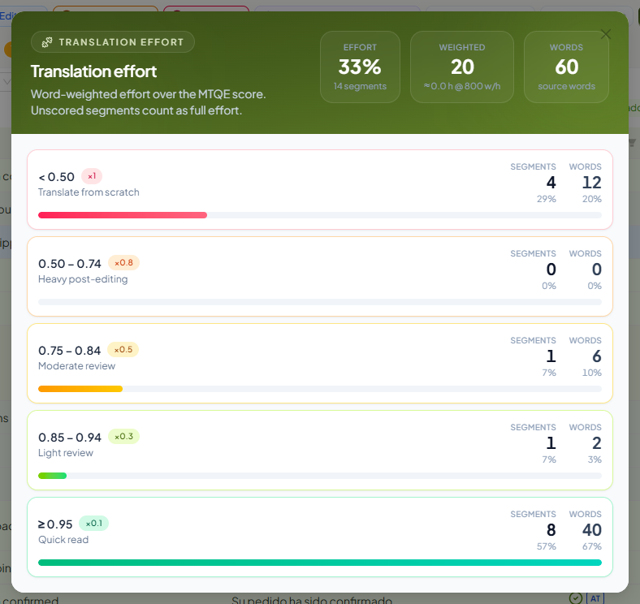

| Banda de nota | Trabajo esperado | Peso |
|---|---|---|
| Menos de 0,50 | Traducir de nuevo | ×1 |
| 0,50 – 0,74 | Posedición intensa | ×0,8 |
| 0,75 – 0,84 | Revisión moderada | ×0,5 |
| 0,85 – 0,94 | Revisión ligera | ×0,3 |
| 0,95 o más | Lectura rápida | ×0,1 |

Arriba salen el esfuerzo total en porcentaje, las palabras ponderadas con las horas estimadas (a 800 palabras por
hora) y las palabras del original. Los segmentos sin nota cuentan como esfuerzo completo.

## Memorias que se actualizan al confirmar

El botón del cilindro, junto al de esfuerzo, abre **Translation memory updates**. Lista las memorias del documento
con un interruptor cada una.

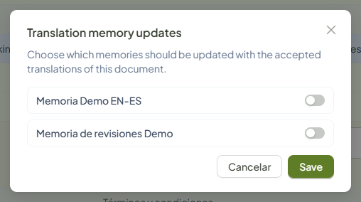

Las memorias que actives recibirán las traducciones que se confirmen en este documento. **Vienen todas
desactivadas**: si quieres alimentar una memoria con este trabajo, actívala antes de empezar a confirmar y pulsa
**Save**.

## Atajos de teclado

| Atajo | Acción |
|---|---|
| `Ctrl+Enter` | Confirmar el segmento y pasar al siguiente |
| `Ctrl+Mayús+Enter` | Rechazar el segmento |
| `Ctrl+S` | Guardar lo escrito sin confirmar |
| `Ctrl+Mayús+↓` · `Ctrl+Mayús+↑` | Ir al segmento siguiente · anterior |
| `Ctrl+Z` · `Ctrl+Y` | Deshacer · rehacer |
| `Ctrl+,` | Insertar la siguiente etiqueta que falta (no comprobado en esta revisión) |

La rejilla muestra 50 segmentos por página; el selector de abajo cambia de página y de tamaño.
