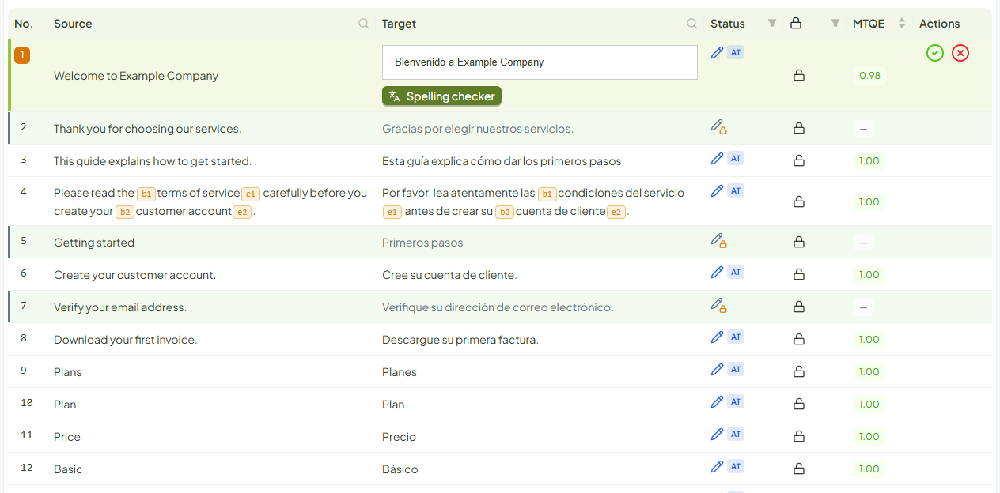
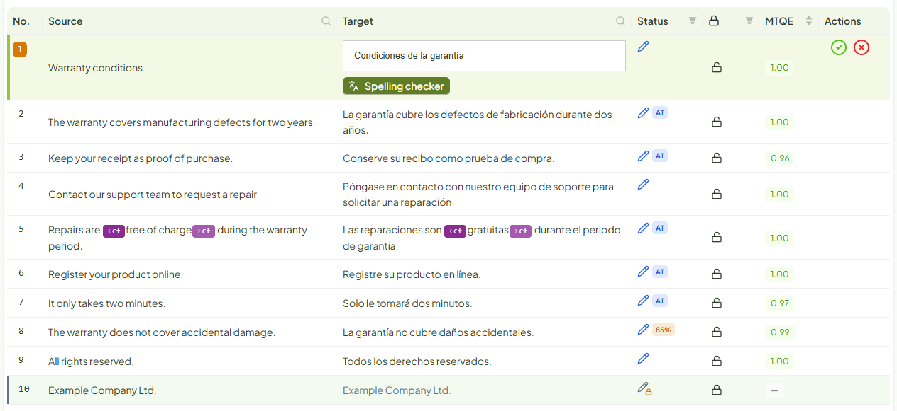

# Formatos y ejemplos

Verificado 2026-10-13 · Fuente: la aplicación en el entorno de pruebas con los ficheros de ejemplo de esta página, y
`lib/utils.js` para la lista de formatos. Comprobados en esta revisión: `.docx`, `.xlf` y `.sdlxliff`.

## Formatos que admite

| Tipo | Extensiones |
|---|---|
| Word | `.docx` `.docm` `.dotx` `.dotm` |
| PowerPoint | `.pptx` `.pptm` `.potx` `.potm` `.ppsx` `.ppsm` |
| Excel | `.xlsx` `.xlsm` `.xltx` `.xltm` |
| OpenDocument | `.odt` `.ott` `.ods` `.ots` `.odp` `.otp` `.odg` `.otg` |
| Otros documentos | `.pdf` `.txt` `.po` `.idml` |
| Bilingües | `.xlf` `.xliff` `.sdlxliff` |

El fichero descargado tiene el mismo formato que el subido y se llama igual más los idiomas: de
`guia-de-bienvenida.docx` sale `guia-de-bienvenida-en_es.docx`. La excepción es el PDF: se convierte a Word al
subirlo y se devuelve como `.docx` (según el código; no comprobado en esta revisión).

## Ficheros de ejemplo

Son los que aparecen en las capturas de este manual. Puedes descargarlos y subirlos a un proyecto de prueba.

| Fichero | Qué es |
|---|---|
| [`guia-de-bienvenida.docx`](ejemplos/guia-de-bienvenida.docx) | Documento de Word con títulos, negrita, cursiva, lista, tabla y un enlace |
| [`ejemplo-tienda.xlf`](ejemplos/ejemplo-tienda.xlf) | XLIFF 1.2 con una unidad para cada situación posible |
| [`ejemplo-garantia.sdlxliff`](ejemplos/ejemplo-garantia.sdlxliff) | Fichero de Trados con segmentos en distintos estados |
| [`memoria-demo.tmx`](ejemplos/memoria-demo.tmx) | Memoria de 10 unidades, inglés a español |
| [`glosario-demo.csv`](ejemplos/glosario-demo.csv) | Glosario de 6 términos, inglés a español |

Todos van de inglés a español.

## Documentos de Office y similares (`.docx`)

La plataforma saca el texto del documento, lo parte en frases y lo traduce. El formato (negritas, enlaces, tablas)
no se pierde: viaja en forma de etiquetas dentro de cada segmento y se repone al descargar.



Lo que se ve en el ejemplo:

- **Cada frase es un segmento**, también cada celda de la tabla y cada elemento de la lista.
- Los segmentos cuya frase estaba **exactamente en la memoria** llegan ya **bloqueados** y con la traducción de la
  memoria. En el ejemplo son cinco, entre ellos «Thank you for choosing our services.».
- El resto llega con la traducción automática, marcada `AT`, sin revisar.
- La frase con negrita y cursiva lleva dos parejas de etiquetas, `b1 … e1` y `b2 … e2`.

Al descargar, el documento conserva su diseño con el texto traducido.

## XLIFF (`.xlf`, `.xliff`)

Un XLIFF ya trae unidades, y cada una puede venir sin traducir, traducida o aprobada. La plataforma respeta lo que
trae. El fichero [`ejemplo-tienda.xlf`](ejemplos/ejemplo-tienda.xlf) tiene una unidad de cada caso:

| Unidad | Qué trae el fichero | Cómo aparece en el editor | Qué sale al descargar, una vez confirmado |
|---|---|---|---|
| `u1` | Sin destino | Segmento 1, traducido por la plataforma (`AT`) | El destino, con `state="translated"` |
| `u2` | Destino vacío y dos frases | **Dos segmentos**, 2 y 3: la unidad se parte por frases | Las dos frases juntas en su único destino |
| `u3` | Traducida (`state="translated"`) | Segmento 4, con su traducción, sin revisar y sin `AT` | Su traducción, confirmada |
| `u4` | Marcada pendiente (`needs-translation`) con una copia del original | Segmento 5, traducido por la plataforma | El destino traducido |
| `u5` | Destino sin estado que copia el original | Segmento 6, traducido por la plataforma | El destino traducido |
| `u6` | Aprobada (`state="signed-off"`) | Segmento 7, **bloqueado** | Igual que entró |
| `u7` | Aprobada (`approved="yes"`) | Segmento 8, **bloqueado** | Igual que entró |
| `u8` | Definitiva (`state="final"`) | Segmento 9, **bloqueado** | Igual que entró |
| `u9` | No traducible (`translate="no"`) | **No aparece** | Igual que entró |
| `u10` | Etiquetas de formato en medio del texto | Segmento 10, con las etiquetas como fichas | Las etiquetas originales en su sitio |
| `u11` | Códigos al principio y al final | Segmento 11, **sin esos códigos** | Los códigos repuestos alrededor de la traducción |
| `u12` | El mismo texto que `u1` | Segmento 12; se confirma solo al confirmar el 1 | El destino traducido |
| `u13` | Traducida y con etiquetas | Segmento 13, con su traducción y sus etiquetas, sin revisar | Su traducción, confirmada |
| `u14` | Traducida pendiente de revisión (`needs-review-translation`) | Segmento 14, con su traducción, sin revisar | Su traducción, confirmada |

Tres reglas resumen la tabla:

- **Lo aprobado por el cliente no se toca.** Llega bloqueado y sale byte a byte como entró.
- **Lo que viene traducido se conserva** y queda pendiente de que alguien lo confirme.
- **Solo lo que viene sin traducir se manda a traducir.** Una copia del original no cuenta como traducción.

En el ejemplo, la primera frase de `u2`, «We have received your payment.», estaba en la memoria: su segmento llegó
bloqueado por coincidencia exacta.

Así queda `u2` en el fichero descargado, con sus dos frases de vuelta en un solo destino:

```xml
<trans-unit id="u2">
  <source>We have received your payment. Your order will be shipped within two working days.</source>
  <target state="translated">Hemos recibido su pago. Su pedido se enviará en un plazo de dos días laborables.</target>
</trans-unit>
```

Y `u11`, con los códigos de los bordes repuestos:

```xml
<trans-unit id="u11">
  <source><x id="2" ctype="x-html-p"/>Thank you for shopping with us.<x id="3" ctype="x-html-p"/></source>
  <target state="translated"><x id="2" ctype="x-html-p"/>Gracias por comprar con nosotros.<x id="3" ctype="x-html-p"/></target>
</trans-unit>
```

En una entrega parcial, lo que la plataforma tradujo y nadie confirmó sale como `needs-translation`, y lo rechazado
como `needs-review-translation` (comprobado en el QA del 2026-10-07, no en esta revisión).

## Trados (`.sdlxliff`)

Un `.sdlxliff` ya viene segmentado por Trados. La plataforma no vuelve a partir nada y mantiene la numeración: el
segmento 8 del editor es el segmento 8 de Trados.



| Segmento | Cómo viene de Trados | Cómo aparece en el editor | En una descarga sin confirmar nada |
|---|---|---|---|
| 1 | Aprobado (`ApprovedTranslation`) | Con su traducción, sin revisar | Igual que entró |
| 2 | Vacío | Traducido por la plataforma (`AT`) | Borrador, origen traducción automática (`Draft`, `mt`) |
| 3 | Borrador de traducción automática | Con su traducción, `AT` | Igual que entró |
| 4 | Traducido (`Translated`) | Con su traducción, sin revisar | Igual que entró |
| 5 | Vacío, con una etiqueta de formato | Traducido, con la etiqueta como ficha | Borrador, con la etiqueta en su sitio |
| 6 y 7 | Dos segmentos vacíos de una misma unidad | Dos segmentos traducidos | Borrador cada uno |
| 8 | Coincidencia parcial de memoria al 85 % | Con su traducción y la etiqueta `85%` | Igual que entró |
| 9 | Coincidencia exacta de memoria | Con su traducción, sin revisar | Igual que entró |
| 10 | Bloqueado | **Bloqueado** | Igual que entró |

Al confirmar un segmento, el fichero descargado lo marca como traducido (`Translated`) y, si lo rechazas, como
traducción rechazada (`RejectedTranslation`), que es lo que Trados espera (comprobado en el QA del 2026-10-07, no en
esta revisión).

## Memorias y glosarios

- **Memorias:** fichero **TMX**, de hasta 100 MB.
- **Glosarios:** fichero **CSV o TSV** con dos columnas, origen y destino, sin cabecera.

Cómo importarlos está en el [manual del Administrador](administrador.md#memorias-de-traduccion).
