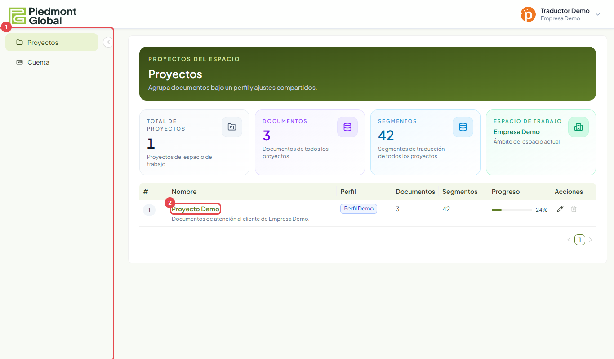
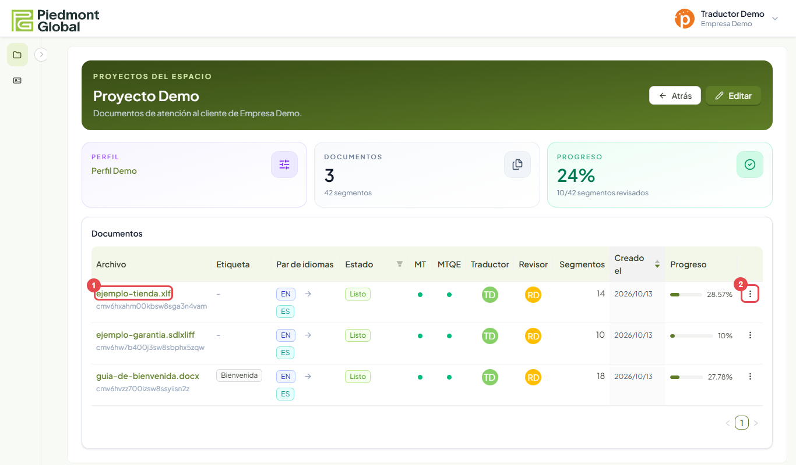
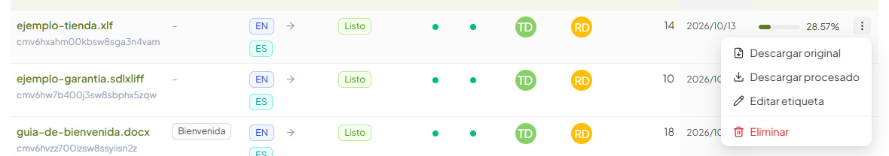
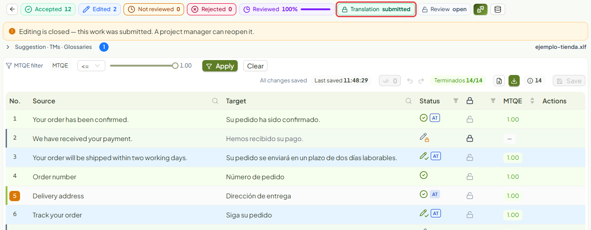
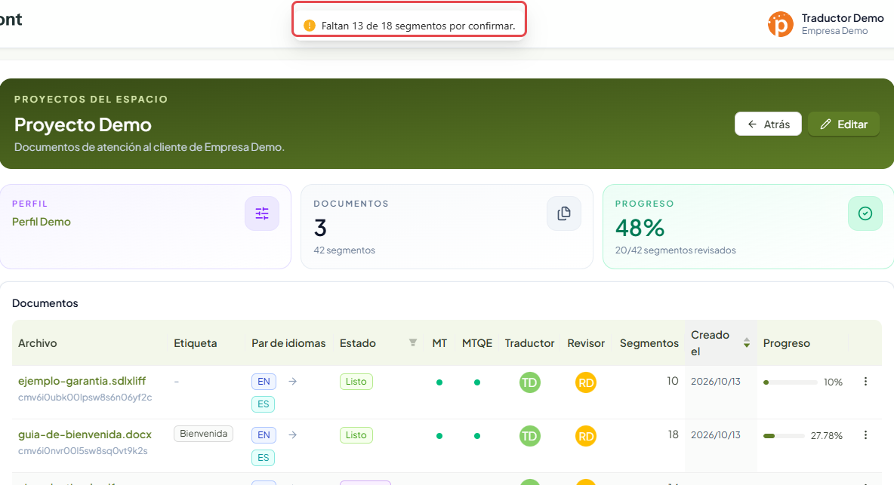

# Manual del Usuario

Verificado 2026-10-13 · Fuente: la aplicación en el entorno de pruebas, con el usuario «Traductor Demo» del espacio
«Empresa Demo».

El Usuario es quien traduce o revisa. Trabaja en los documentos que un Administrador le asigna, como **traductor**
o como **revisor**, y no ve nada más.

## Lo que ves al entrar

1. El **menú** tiene solo dos entradas: **Proyectos** y **Cuenta**. No hay memorias, glosarios, perfiles ni
   usuarios: los gestiona el Administrador.
2. En la lista aparecen únicamente los **proyectos en los que tienes algún documento asignado**. Pulsa el nombre
   para entrar.

Si la lista está vacía, todavía no te han asignado nada. Avisa a tu Administrador.

## Tus documentos

Dentro del proyecto ves solo los documentos que tienes asignados.

1. Pulsa el **nombre del documento** para abrirlo en el editor. Solo se puede abrir cuando su estado es **Listo**.
2. El menú **⋮** tiene las descargas.

Las columnas **Traductor** y **Revisor** muestran las iniciales de quién tiene cada papel, y **Progreso** el
avance de la revisión.

### El menú de un documento

| Opción | Qué hace |
|---|---|
| Descargar original | Baja el fichero tal como se subió |
| Descargar procesado | Baja el fichero traducido, cuando el documento está terminado |
| Editar etiqueta | Cambia la etiqueta del documento |
| Eliminar | **Elimina el documento para todo el equipo** |

No uses **Eliminar** ni el botón **Editar** de la cabecera del proyecto salvo que tu Administrador te lo pida: en
esta versión la plataforma te deja hacerlo y el cambio afecta a todos.

## Revisar un documento

Abre el documento y trabaja en el editor. Está explicado paso a paso en [El editor](editor.md). En resumen:

1. Pulsa un segmento para abrirlo.
2. Si la traducción es correcta, **confírmala** con `Ctrl+Enter`.
3. Si no lo es, **corrígela** y confirma con `Ctrl+Enter`.
4. Si no puedes resolverla, **recházala** con `Ctrl+Mayús+Enter` y sigue.
5. Repite hasta que el contador **Terminados** llegue al total.

Los segmentos bloqueados ya están resueltos: no se editan y el editor los salta.

## Traductor y revisor

Los dos papeles usan el mismo editor y pueden hacer lo mismo en él. La diferencia es el orden del trabajo y cuándo
se cierra:

| Papel | Cuándo trabaja | Cuándo deja de poder editar |
|---|---|---|
| Traductor | Primero | Cuando el Administrador marca la **traducción entregada** |
| Revisor | Después del traductor | Cuando el Administrador marca la **revisión entregada** |

Con la traducción entregada y la revisión abierta, el revisor sigue pudiendo editar y el traductor no.

## Terminar y entregar

Has terminado cuando todos los segmentos están confirmados o bloqueados. El contador **Terminados** se pone en
verde con el total, por ejemplo «Terminados 14/14».

1. **Terminados** indica cuántos segmentos están resueltos.
2. **Descargar procesado** se activa al llegar al total.

**No tienes botón para entregar.** Avisa a tu Administrador de que has terminado; es él quien marca la entrega.

### Cuando tu trabajo está entregado

Desde que el Administrador marca la entrega, el documento queda cerrado para ti. Puedes abrirlo y consultarlo, pero
no cambiar nada. El editor lo avisa arriba, en inglés: «Editing is closed — this work was submitted. A project
manager can reopen it.»

Si hay que corregir algo, pide a tu Administrador que reabra la traducción o la revisión.

## Descargar

- **Descargar original** está siempre disponible.
- **Descargar procesado** solo entrega el fichero cuando el documento está terminado. Si falta trabajo, la
  plataforma te dice cuántos segmentos quedan por confirmar y no descarga nada. La entrega parcial es cosa del
  Administrador.

## Tu cuenta

El idioma de la interfaz y tu contraseña se cambian en **Cuenta**. Está explicado en
[Acceso y cuenta](acceso.md#cuenta).
